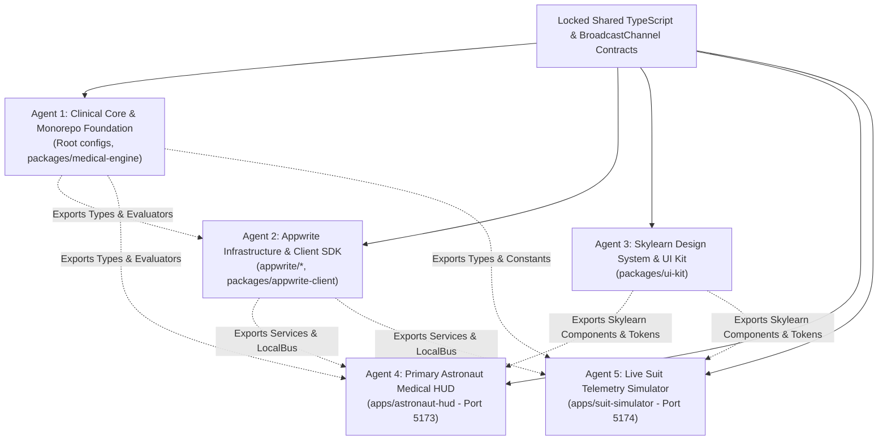

# AURA: Master AI-Executable Parallel Implementation Plan (5-Agent Architecture)

* **Project:** AURA (Autonomous Unified Recovery & Assessment) — NASA Space Apps Challenge 2026
* **Source Specifications Analyzed (100% Coverage):**
  1. `docs/aura_master_ai_ready_architecture_service_specification (2).md` (Space Medicine Architecture, Mathematical Formulations, Isomorphic Triage Engine, Appwrite Cloud/Edge Infrastructure, 3D Holographic Digital Twin, DTN Comms, Suit Simulator)
  2. `docs/skylearn-DESIGN.md` (Skylearn Design System — Color Tokens, Dyslexia/Low-Vision Accessible Typography, Soft Elevation, Radii, 15 Core UI Components, Spacing, Spring Motion, Custom 2px Iconography, WCAG-AAA Accessibility, Voice & Tone, Do's & Don'ts)
* **Target Executor:** Autonomous AI Coding Models (Gemini Hydrogen, Gemini Flash, Cursor, Windsurf) operating in a **5-Agent Parallel Swarm**
* **Document Role:** Complete, zero-hallucination architectural & task specification.

---

## 1. Cross-Document Synthesis & Zero-Omission Analysis

### 1.1 Architectural Unification: Why AURA + Skylearn Form One Cohesive System
AURA solves four fundamental spaceflight medical challenges, and the **Skylearn Design System** directly powers the human-factors layer required by those challenges:

1. **Lack of Onboard Medical Specialists & Cognitive Impairment in Crisis:**
   * *Space Medicine Reality:* Crew members are often engineers experiencing microgravity $\text{CO}_2$ headaches (hypercapnia), Spaceflight-Associated Neuro-ocular Syndrome (SANS / visual blurring), or acute fatigue.
   * *Skylearn Solution:* Mandatory **Atkinson Hyperlegible** body typography (designed specifically for low-vision and dyslexia legibility with distinct letterforms and open apertures), minimum `16px` font size (`18px–20px` for instructions), `56px` minimum square tap targets (`64px` height on `BigFriendlyButton` for gloved or trembling hands in microgravity), a translucent Sky **Reading-Ruler overlay**, and an explicit **"Read to me"** voice synthesis button on every emergency protocol passage.
2. **Psychological Fatigue & Countermeasure Neglect:**
   * *Space Medicine Reality:* Isolation and circadian misalignment cause astronauts to skip daily hydration (`HYDRATION_2500ML`), resistive workouts (`ARED_WORKOUT`), and light therapy (`CIRCADIAN_LIGHT_SYNC`), leading to hypovolemia, kidney stones, and bone loss.
   * *Skylearn Solution:* Gamified adherence using Skylearn's **Lesson Card** (for Daily Countermeasures), **Star Badge** (64px Sun-filled circles in Bronze/Silver/Gold stacks), **Streak Counter** (Sun-filled flame icon with tabular display numbers), **Progress Bar** (8px tall, 999px radius, Leaf fill on Sky-Soft track with milestone sparkles), **Quiz Score Card** (mapped to the **Mission Readiness & Sol Summary Card**), and **Confetti Celebration** (1.6s burst in Sky, Sun, Leaf, and Berry on full daily completion).
3. **Calm, Non-Punitive Alerting vs. Raw Telemetry Inspection:**
   * *Space Medicine Reality:* Crew members need calm, actionable guidance ("Let's check your fan alignment") without panic-inducing alarms, whereas Earth Flight Surgeons and Hackathon Judges need dense mathematical telemetry ($Z$-scores, $\mu_{\text{adj}} \pm 2\sigma_{\text{eff}}$ bands, raw JSON packets, and 3D anatomical meshes).
   * *Skylearn Solution:* The Skylearn **Parent View Switcher** is implemented as the **Crew Mode / Flight Surgeon Mode Switcher**:
     * **Crew Mode (Skylearn Default):** Warm, bright white/cool-tinted surfaces (`#FFFFFF`, `#F8FAFC`), generous spacing (`48px` section gaps), `Atkinson Hyperlegible` plain-language explanations, **Gentle Coral (`#F87171` / `#FEE2E2`)** for critical/error states (never harsh punitive red), **Sun (`#FBBF24`)** for caution/rewards, and **Leaf (`#22C55E`)** for nominal/completed states.
     * **Flight Surgeon / Telemetry Mode:** Denser layout using `JetBrains Mono` for tabular Z-scores, $\sigma$ multipliers, light-time propagation counters, Recharts confidence bands, and the embedded 3D Holographic Digital Twin viewport (`#0F172A` Ink canvas container).

---

### 1.2 Complete Audit of Mathematical Formulations & Clinical Constants (Zero Hallucination Reference)

Every agent touching clinical logic or UI display MUST use these exact equations and constants without modification:

#### A. Mathematical Equations (`@aura/medical-engine`)
1. **Phase-Adjusted Personal Baseline ($\mu_{\text{adj}, m}$):**
   $$\mu_{\text{adj}, m} = \text{round\_2\_decimals}(\mu_{\text{earth}, m} + \Delta_{\text{phase}, m})$$
2. **Effective Phase Standard Deviation ($\sigma_{\text{eff}, m}$):**
   $$\sigma_{\text{eff}, m} = \max\left(0.1,\; \sigma_{\text{earth}, m} \times \kappa_{\text{phase}}\right)$$
3. **Personal Adjusted Z-Score ($Z_m$):**
   $$Z_m = \text{round\_2\_decimals}\left(\frac{\lvert X_m - \mu_{\text{adj}, m} \rvert}{\sigma_{\text{eff}, m}}\right)$$
   * **Primary Filter (NASA Hard Limits):** If $X_m \le \text{minCritical}$ OR $X_m \ge \text{maxCritical}$ $\rightarrow$ `severity = 'red'`, `triggerType = 'HARD_CLINICAL_LIMIT'`, `zScore = 9.9`.
   * **Environmental Metrics (`cabin_co2_mmhg`, `cabin_radiation_msv`):** No personal Earth baseline (`adjustedMean = null`, `zScore = 0`, `deviationPercent = 0`, `triggerType = 'ENVIRONMENTAL_NOMINAL'`). Elevated (`yellow`) if `cabin_co2_mmhg >= 3.8` or `cabin_radiation_msv >= 1.2` (and below hard limit); otherwise `green`.
   * **Secondary Filter (Personal Z-Score):**
     * $Z_m \ge 3.0 \rightarrow$ `severity = 'red'`, `triggerType = 'SEVERE_PERSONAL_DEVIATION'`
     * $2.0 \le Z_m < 3.0 \rightarrow$ `severity = 'yellow'`, `triggerType = 'MODERATE_PERSONAL_DEVIATION'`
     * $Z_m < 2.0 \rightarrow$ `severity = 'green'`, `triggerType = 'NOMINAL'`
4. **Visual Deviation Percentage ($\text{Deviation}_{\%}$):**
   $$\text{Deviation}_{\%} = \text{Math.round}\left(\left(\frac{X_m - \mu_{\text{adj}, m}}{\mu_{\text{adj}, m}}\right) \times 100\right)$$
5. **Mission Readiness Score ($R_{\text{mission}}$):**
   * $S_{\text{vitals}} = \max(0,\; 100 - 15 \cdot N_{\text{yellow}} - 40 \cdot N_{\text{red}})$
   * $S_{\text{countermeasures}} = \text{totalTasksCount} > 0 \implies \min(100,\; \text{Math.round}((\text{completedTasksCount} / \text{totalTasksCount}) \times 100)) \text{ else } 100$
   * $S_{\text{sleep\_mood}} = \text{Math.round}\left(\min(\text{sleepHours} / 7.5,\; 1.0) \times 50 + \min(\max(\text{moodScore}, 0) / 10,\; 1.0) \times 50\right)$
   * $R_{\text{mission}} = \text{Math.round}(0.50 \cdot S_{\text{vitals}} + 0.30 \cdot S_{\text{countermeasures}} + 0.20 \cdot S_{\text{sleep\_mood}})$
   * **Readiness Status Label:**
     * If $N_{\text{red}} > 0$ OR $R_{\text{mission}} < 55 \rightarrow$ `'NO_GO_MEDICAL_HOLD'`
     * Else if $N_{\text{yellow}} > 0$ OR $R_{\text{mission}} < 80 \rightarrow$ `'CAUTION_MONITOR'`
     * Else $\rightarrow$ `'OPTIMAL_FOR_EVA'`

#### B. Exact NASA Clinical Hard Limits Table (`hardLimits.ts`)
| Metric Key (`MetricKey`) | `minCritical` | `maxCritical` | `unit` | `label` | Env Yellow Threshold |
| :--- | :---: | :---: | :---: | :--- | :---: |
| `heart_rate` | `42` | `145` | `'bpm'` | `'Heart Rate'` | N/A |
| `bp_systolic` | `85` | `160` | `'mmHg'` | `'Systolic BP'` | N/A |
| `bp_diastolic` | `50` | `100` | `'mmHg'` | `'Diastolic BP'` | N/A |
| `blood_glucose` | `65` | `185` | `'mg/dL'` | `'Blood Glucose'` | N/A |
| `body_temp` | `35.5` | `38.3` | `'degC'` | `'Core Temp'` | N/A |
| `spo2` | `91` | `100` | `'%'` | `'Oxygen Saturation'` | N/A |
| `cabin_co2_mmhg` | `0` | `5.0` | `'mmHg'` | `'Cabin CO2'` | `>= 3.8` |
| `cabin_radiation_msv` | `0` | `2.0` | `'mSv/day'` | `'Radiation Dose'` | `>= 1.2` |

#### C. Exact Mission Phase Offsets Table (`phaseOffsets.ts`)
| Mission Phase (`MissionPhase`) | `heart_rate` | `bp_systolic` | `bp_diastolic` | `blood_glucose` | `body_temp` | `spo2` | `stdDevMultiplier` ($\kappa$) |
| :--- | :---: | :---: | :---: | :---: | :---: | :---: | :---: |
| `PRE_FLIGHT_BDC` | `0` | `0` | `0` | `0` | `0` | `0` | `1.0` |
| `LAUNCH_ASCENT` | `+30` | `+18` | `+10` | `+12` | `+0.2` | `-1` | `1.8` |
| `EARLY_ORBIT_ADAPTATION` | `+6` | `+8` | `-4` | `+5` | `+0.1` | `0` | `1.25` |
| `DEEP_SPACE_CRUISE` | `-2` | `-3` | `-5` | `0` | `0` | `0` | `1.0` |

#### D. Exact Default Astronaut Profile, Pre-Flight BDC Baselines & Default Daily Missions (`config.ts` & `CountermeasureService.ts`)
* **Default Astronaut Profile (`DEFAULT_ASTRONAUT_PREFS`):**
  * `astronautCode`: `'AST-CDR-01'`
  * `fullName`: `'Cmdr. Tariq Al-Mansoor'`
  * `bloodType`: `'O+'`
  * `missionPhase`: `'EARLY_ORBIT_ADAPTATION'`
  * `earthBaselines`:
    * `heart_rate`: `{ mean: 56, stdDev: 4 }`
    * `bp_systolic`: `{ mean: 114, stdDev: 7 }`
    * `bp_diastolic`: `{ mean: 72, stdDev: 5 }`
    * `blood_glucose`: `{ mean: 90, stdDev: 8 }`
    * `body_temp`: `{ mean: 36.7, stdDev: 0.25 }`
    * `spo2`: `{ mean: 98, stdDev: 1 }`
* **Default Daily Missions (`DEFAULT_DAILY_MISSIONS`):**
  | `$id` | `astronaut_id` | `task_code` | `task_title` | `target_system` | `points_value` | `is_completed` | `streak_days` |
  | :--- | :--- | :--- | :--- | :--- | :---: | :---: | :---: |
  | `'task_hydration_01'` | `'AST-CDR-01'` | `'HYDRATION_2500ML'` | `'Electrolyte Hydration Target (2500 mL)'` | `'cardiovascular'` | `35` | `true` | `14` |
  | `'task_ared_02'` | `'AST-CDR-01'` | `'ARED_WORKOUT'` | `'ARED Resistive Exercise (60 Min Load)'` | `'musculoskeletal'` | `40` | `true` | `11` |
  | `'task_circadian_03'` | `'AST-CDR-01'` | `'CIRCADIAN_LIGHT_SYNC'` | `'2700K Amber Circadian Visor Protocol'` | `'nervous'` | `25` | `true` | `9` |
* **Light-Time Propagation Delays (`LIGHT_TIME_DELAY_SECONDS`):**
  * `ISS_REALTIME`: `1` second
  * `MOON_2S`: `3` seconds
  * `MARS_15M`: `25` seconds (scaled for live judge demo visibility)
  * `SOLAR_BLACKOUT`: `null` (infinite delay until solar conjunction clears; queues in IndexedDB)

#### E. Exact 5 Visual Guides Metadata (`STORAGE_VISUAL_GUIDES` in `protocols.ts`)
| `fileId` | `title` | `durationSec` | `equipmentLocation` | `fallbackSteps` (Exact 3-Step Array) |
| :--- | :--- | :---: | :--- | :--- |
| `'guide_co2_airflow_check'` | `'Microgravity CO2 Pocket Dispersion & Fan Alignment'` | `45` | `'Crew Quarters Port Bulkhead - Rack B2'` | 1. `'Translate immediately 2 meters away from your current work/sleep station.'`<br>2. `'Switch Personal Ventilation Fan (PVF) to HIGH (3000 RPM) and angle nozzle 45 degrees across face.'`<br>3. `'Verify CDRA (Carbon Dioxide Removal Assembly) indicator light is solid green.'` |
| `'guide_zero_g_bp_cuff'` | `'Zero-G Sphygmomanometer Calibration & AstroRad Donning'` | `60` | `'Crew Medical Restraint System (CMRS) - Locker M1'` | 1. `'Enter the Crew Storm Shelter lined with polyethylene water bags.'`<br>2. `'Secure the AstroRad vest around torso and pelvis.'`<br>3. `'Fasten the automated brachial cuff on left upper arm and keep arm tethered at heart level.'` |
| `'guide_hydration_electrolyte'` | `'Potable Water Dispenser (PWD) Electrolyte Reconstitution'` | `30` | `'Galley Node 1 - Ambient Water Port'` | 1. `'Attach oral rehydration salt (ORS) pouch to the Potable Water Dispenser septum.'`<br>2. `'Dispense 400 mL of ambient water and massage pouch for 20 seconds to dissolve solutes.'`<br>3. `'Consume steadily over 10 minutes to restore intravascular plasma volume.'` |
| `'guide_space_glucometer'` | `'Capillary Blood Sampling in Microgravity & Circadian Lighting'` | `40` | `'Ambulatory Medical Pack (AMP) - Pouch 3'` | 1. `'Ingest one 15g fast-acting glucose gel packet immediately.'`<br>2. `'Wipe ring finger with alcohol swab; allow to air dry completely so droplet remains spherical in 0G.'`<br>3. `'Touch test strip tip directly to the surface tension bead without smearing.'` |
| `'guide_ared_resistive_load'` | `'ARED Vacuum Cylinder Calibration & Lower-Body Negative Pressure'` | `50` | `'Tranquility Node 3 - ARED Platform'` | 1. `'Engage ARED flywheel and vacuum canisters to 75% Earth body-weight equivalent.'`<br>2. `'Perform 3 sets of heel raises and squats with telemetry harness active.'`<br>3. `'Log completion in Daily Countermeasures to restore musculoskeletal readiness.'` |

#### F. Exact 8-Rule Correlation Matrix Evaluation Order & Verbatim Clinical Copy (`correlationEngine.ts`)
The function `runAutonomousTriage(vitalReading, userBaselines, missionPhase, incompleteTasks)` MUST evaluate rules in this exact top-to-bottom priority order (first match returns):

1. **Rule 1 — Microgravity Localized $\text{CO}_2$ Pocket (`HYPERCAPNIA_CO2_POCKET`):**
   * *Condition:* `vitalReading.cabin_co2_mmhg >= 4.0 && (evals.heart_rate.severity !== 'green' || vitalReading.mood_score <= 4 || vitalReading.spo2 <= 94)`
   * *Critical check:* `isCritical = vitalReading.cabin_co2_mmhg >= 5.0 || evals.spo2.severity === 'red'`
   * *Output Fields:*
     * `affected_system`: `'nervous'`
     * `severity`: `isCritical ? 'red' : 'yellow'`
     * `diagnosis_code`: `'HYPERCAPNIA_CO2_POCKET'`
     * `diagnosis_title`: `'Localized Microgravity CO2 Pocket (Hypercapnia Risk)'`
     * `simple_explanation`: `'Without gravity-driven convection, warm exhaled air does not rise. A stagnant bubble of CO2 has formed around your head, triggering elevated heart rate, cerebral vasodilation headache, and cognitive/mood decline.'`
     * `action_protocol`:
       1. `'Immediately translate at least 2 meters away from your current station to break the stagnant air pocket.'`
       2. `'Direct your Personal Ventilation Fan (PVF) toward your face at maximum RPM.'`
       3. `'Perform slow diaphragmatic breathing for 3 minutes and inspect the CDRA CO2 scrubber intake.'`
     * `guide_file_id`: `'guide_co2_airflow_check'`
     * `notify_earth`: `isCritical`

2. **Rule 2 — Solar Particle Event & Acute Cardiovascular Radiation Stress (`ACUTE_RADIATION_CARDIO_STRESS`):**
   * *Condition:* `vitalReading.cabin_radiation_msv >= 1.5 && (evals.heart_rate.severity === 'red' || evals.body_temp.severity !== 'green')`
   * *Output Fields:*
     * `affected_system`: `'cardiovascular'`
     * `severity`: `'red'`
     * `diagnosis_code`: `'ACUTE_RADIATION_CARDIO_STRESS'`
     * `diagnosis_title`: `'Acute Solar Radiation & Cardiovascular Stress'`
     * `simple_explanation`: `'A spike in cabin radiation dose is coinciding with elevated core temperature and tachycardia, indicating acute autonomic and hematological stress.'`
     * `action_protocol`:
       1. `'Relocate immediately to the high-shielding polyethylene/water Storm Shelter.'`
       2. `'Don the AstroRad selective-shielding vest to protect bone marrow and vital organs.'`
       3. `'Consume 500 mL of antioxidant electrolyte solution and perform a confirmatory zero-G blood pressure check.'`
     * `guide_file_id`: `'guide_zero_g_bp_cuff'`
     * `notify_earth`: `true`

3. **Rule 3 — Space Dehydration Linked to Missed Hydration Countermeasure (`MICROGRAVITY_HYPOVOLEMIA`):**
   * *Condition:* `evals.heart_rate.severity !== 'green' && vitalReading.bp_systolic < userBaselines.bp_systolic.mean && incompleteTasks.includes('HYDRATION_2500ML')`
   * *Output Fields:*
     * `affected_system`: `'cardiovascular'`
     * `severity`: `'yellow'`
     * `diagnosis_code`: `'MICROGRAVITY_HYPOVOLEMIA'`
     * `diagnosis_title`: `'Subclinical Space Dehydration (Countermeasure Incomplete)'`
     * `simple_explanation`: `'Microgravity suppresses your natural thirst reflex via central fluid shift. Your elevated heart rate and lower systolic pressure correlate directly with an incomplete daily hydration task.'`
     * `action_protocol`:
       1. `'Dispense and drink 400 mL of electrolyte-fortified water from the Potable Water Dispenser immediately.'`
       2. `'Avoid rapid head rotations to prevent vestibular orthostatic dizziness.'`
       3. `'Mark the HYDRATION_2500ML task complete in Daily Countermeasures to restore Mission Readiness.'`
     * `guide_file_id`: `'guide_hydration_electrolyte'`
     * `notify_earth`: `false`

4. **Rule 4 — Hypoglycemia & Circadian Drift (`METABOLIC_CIRCADIAN_DRIFT`):**
   * *Condition:* `evals.blood_glucose.severity !== 'green' || (vitalReading.sleep_hours < 5.0 && vitalReading.mood_score <= 4)`
   * *Critical check:* `isCriticalGlucose = vitalReading.blood_glucose <= 65 || evals.blood_glucose.severity === 'red'`
   * *Output Fields:*
     * `affected_system`: `'metabolic'`
     * `severity`: `isCriticalGlucose ? 'red' : 'yellow'`
     * `diagnosis_code`: `'METABOLIC_CIRCADIAN_DRIFT'`
     * `diagnosis_title`: `'Metabolic Energy Deficit & Circadian Desynchronization'`
     * `simple_explanation`: `'Insufficient sleep duration combined with blood glucose deviation is impairing your metabolic equilibrium and reaction speed for mission-critical tasks.'`
     * `action_protocol`:
       1. `'Consume one 15g fast-acting oral glucose pouch from the Ambulatory Medical Pack.'`
       2. `'Re-verify capillary blood glucose in 15 minutes using the zero-G surface-tension glucometer.'`
       3. `'Shift cabin solid-state lighting to 2700K amber spectrum 90 minutes prior to scheduled sleep.'`
     * `guide_file_id`: `'guide_space_glucometer'`
     * `notify_earth`: `isCriticalGlucose`

5. **Rule 5 — Musculoskeletal Deconditioning Risk (`MUSCULOSKELETAL_UNLOADING_RISK`):**
   * *Condition:* `incompleteTasks.includes('ARED_WORKOUT') && vitalReading.sleep_hours < 6.0 && missionPhase === 'DEEP_SPACE_CRUISE'`
   * *Output Fields:*
     * `affected_system`: `'musculoskeletal'`
     * `severity`: `'yellow'`
     * `diagnosis_code`: `'MUSCULOSKELETAL_UNLOADING_RISK'`
     * `diagnosis_title`: `'Microgravity Osteopenia & Muscle Atrophy Risk'`
     * `simple_explanation`: `'Unloaded posture in deep space causes 1.5% monthly bone mineral loss unless countered by resistive loading. Your ARED resistive workout remains incomplete today.'`
     * `action_protocol`:
       1. `'Complete a 30-minute resistive session on the ARED platform at 75% load calibration.'`
       2. `'Verify Vitamin D3 and calcium metabolic supplementation intake.'`
       3. `'Log the ARED_WORKOUT countermeasure to clear this advisory.'`
     * `guide_file_id`: `'guide_ared_resistive_load'`
     * `notify_earth`: `false`

6. **Rule 6 — General Single-Metric Anomaly Fallback (`BIOMETRIC_DEVIATION_${METRIC_KEY}`):**
   * *Condition:* `worstEval = Object.values(evals).find(e => e.severity === 'red') || Object.values(evals).find(e => e.severity === 'yellow')`
   * *Organ Mapping:* `heart_rate | bp_systolic | bp_diastolic | spo2 | cabin_radiation_msv` $\rightarrow$ `'cardiovascular'`; `blood_glucose | body_temp` $\rightarrow$ `'metabolic'`; `cabin_co2_mmhg` $\rightarrow$ `'nervous'`.
   * *Output Fields:*
     * `affected_system`: `systemMap[worstEval.metricKey] || 'cardiovascular'`
     * `severity`: `worstEval.severity`
     * `diagnosis_code`: `` `BIOMETRIC_DEVIATION_${worstEval.metricKey.toUpperCase()}` ``
     * `diagnosis_title`: `` `Personal Baseline Deviation: ${worstEval.metricKey.replace('_', ' ').toUpperCase()}` ``
     * `simple_explanation`: `worstEval.summary`
     * `action_protocol`:
       1. `'Suspend strenuous EVA or payload operations for 15 minutes.'`
       2. `'Verify biometric sensor skin contact and re-sample telemetry.'`
       3. `'If deviation persists above 3 sigma, initiate Earth medical packet transmission.'`
     * `guide_file_id`: `'guide_zero_g_bp_cuff'`
     * `notify_earth`: `worstEval.severity === 'red'`

7. **Rule 7 — Launch Ascent G-Force Adaptation (`LAUNCH_ASCENT_ADAPTATION`):**
   * *Condition:* `missionPhase === 'LAUNCH_ASCENT'` (and no red/yellow alerts triggered above).
   * *Output Fields:*
     * `affected_system`: `'nominal'`
     * `severity`: `'green'`
     * `diagnosis_code`: `'LAUNCH_ASCENT_ADAPTATION'`
     * `diagnosis_title`: `'Nominal Physiological Response to Launch G-Load'`
     * `simple_explanation`: `'Your elevated heart rate and blood pressure are within expected phase-adjusted parameters for 3G launch acceleration. No pathological anomaly detected.'`
     * `action_protocol`:
       1. `'Maintain Anti-G Straining Maneuver (AGSM) breathing rhythm.'`
       2. `'Keep lower extremity and abdominal muscles isometric to support cerebral perfusion.'`
     * `guide_file_id`: `null`
     * `notify_earth`: `false`

8. **Rule 8 — Default Nominal State (`ALL_SYSTEMS_NOMINAL`):**
   * *Condition:* Fallback when all metrics are `green`.
   * *Output Fields:*
     * `affected_system`: `'nominal'`
     * `severity`: `'green'`
     * `diagnosis_code`: `'ALL_SYSTEMS_NOMINAL'`
     * `diagnosis_title`: `'All Biological Systems Nominal'`
     * `simple_explanation`: `'Your real-time telemetry matches your personal pre-flight baseline adjusted for the current spaceflight phase.'`
     * `action_protocol`:
       1. `'Continue scheduled orbital operations and daily countermeasure regimen.'`
     * `guide_file_id`: `null`
     * `notify_earth`: `false`

---

### 1.3 Complete Audit of Skylearn Design System Tokens & Rules (`skylearn-DESIGN.md`)

Every UI component in `packages/ui-kit`, `apps/astronaut-hud`, and `apps/suit-simulator` MUST adhere to these exact design specifications:

#### A. Color Palette Tokens (Exact Hex Codes)
| Token Name | CSS Variable / Tailwind Token | Hex Value | Required Usage in AURA |
| :--- | :--- | :---: | :--- |
| **Sky** | `--color-sky` / `sky` | `#3B82F6` | Primary brand color, primary CTAs, navigation, active states, active icons |
| **Sky Bright** | `--color-sky-bright` / `sky-bright` | `#60A5FA` | Hover states, soft accents, 1px bottom tactile edge on Big Friendly Button |
| **Sky Deep** | `--color-sky-deep` / `sky-deep` | `#1D4ED8` | Pressed states, button hover fill, focused-input borders |
| **Sky Soft** | `--color-sky-soft` / `sky-soft` | `#DBEAFE` | Background tints for active items, progress bar tracks, Help Bubble bg, 4px input focus ring |
| **Sun** | `--color-sun` / `sun` | `#FBBF24` | Achievement accent — stars, badges, rewards, streaks, `yellow` moderate deviation indicator (NEVER primary actions) |
| **Sun Bright** | `--color-sun-bright` / `sun-bright` | `#FCD34D` | Achievement glow (`0 0 24px rgba(252, 211, 77, 0.4)`) and milestone celebration sparkles |
| **Sun Deep** | `--color-sun-deep` / `sun-deep` | `#D97706` | Hover state and high-contrast text on sun-yellow elements |
| **Leaf** | `--color-leaf` / `leaf` | `#22C55E` | Progress bar fill, nominal (`green`) physiological status, completed countermeasure indicator |
| **Leaf Soft** | `--color-leaf-soft` / `leaf-soft` | `#DCFCE7` | Background tint for nominal status & completed protocol steps |
| **Leaf Deep** | `--color-leaf-deep` / `leaf-deep` | `#16A34A` | Strong nominal/correct indicator & checkmark badge |
| **Coral** | `--color-coral` / `coral` | `#F87171` | Gentle critical/anomaly indicator (`red` severity in Crew UI) — NEVER harsh punitive red |
| **Coral Soft** | `--color-coral-soft` / `coral-soft` | `#FEE2E2` | Background tint for anomaly feedback & emergency protocol cards |
| **Berry** | `--color-berry` / `berry` | `#A855F7` | Secondary accent — deep-space phase badges, "go further" clinical insights, confetti |
| **Background** | `--color-bg` / `bg-page` | `#FFFFFF` | Pure white page background in Crew Mode |
| **Surface** | `--color-surface` / `surface` | `#F8FAFC` | Card and panel surface, subtle cool tint |
| **Surface Elevated** | `--color-surface-elevated` | `#FFFFFF` | Modals, focused protocol drawers |
| **Surface Sunken** | `--color-surface-sunken` | `#F1F5F9` | Inset wells, Drag-and-Drop zones |
| **Ink** | `--color-ink` / `ink` | `#0F172A` | Primary text (deep navy near-black) & 3D Hologram viewport background |
| **Ink Muted** | `--color-ink-muted` / `ink-muted` | `#475569` | Secondary text, instructions, default 24px icons |
| **Ink Subtle** | `--color-ink-subtle` / `ink-subtle` | `#94A3B8` | Metadata, UTC timestamps |
| **Ink Faint** | `--color-ink-faint` / `ink-faint` | `#CBD5E1` | Disabled state, input placeholders |
| **Outline** | `--color-outline` / `outline-default` | `#E2E8F0` | 1px card edges, dividers |
| **Outline Strong** | `--color-outline-strong` | `#94A3B8` | Focus rings, prominent separators, 2px dashed drag-zone borders |

#### B. Typography & Type Scale
* **Font Stacks (Load via Google Fonts / Fontsource in both `index.html` files):**
  * **Display (`--font-display`):** `'Hubot Sans', 'Nunito', 'Quicksand', sans-serif` — Headlines, feature titles, tabular score numbers.
  * **Body Sans (`--font-body`):** `'Atkinson Hyperlegible', 'Nunito Sans', 'Inter', sans-serif` — **MANDATORY** for all body copy, instructions, and UI controls (`letter-spacing: 0.01em`). Minimum font size across all Crew-facing UI is `16px`; instructions are `18px` minimum.
  * **Reading Serif (`--font-reading`):** `'Lexend Deca', 'Source Serif 4', serif` — Optional toggle for long-form protocol reading passages.
  * **Mono (`--font-mono`):** `'JetBrains Mono', monospace` — Math equations, Z-scores, countdown timers, raw telemetry values, tabular scores.
* **Exact Type Scale:**
  * `Hero`: `56px / 60px` (`font-display`, weight `700`)
  * `H1`: `40px / 48px` (`font-display`, weight `700`)
  * `H2`: `32px / 40px` (`font-display`, weight `700`)
  * `H3`: `24px / 32px` (`font-display`, weight `600`)
  * `H4`: `19px / 28px` (`font-body`, weight `600`)
  * `Body Large`: `20px / 32px` (`font-body` — for step-by-step crew instructions)
  * `Body`: `18px / 28px` (`font-body` — for Flight Surgeon / parent-facing copy)
  * `Small`: `16px / 24px` (`font-body` — minimum allowed crew text size)
  * `Caption`: `14px / 20px` (`font-body` — metadata/pills only)
  * `Score Number`: `56px / 56px` (`font-display`, weight `700`, `font-variant-numeric: tabular-nums`)

#### C. Elevation, Shadows & Border Radius
* **Shadows:**
  * Resting card: `1px solid #E2E8F0` (no heavy drop shadow at rest)
  * Card hover lift: `0 8px 24px rgba(15, 23, 42, 0.06)` with `translateY(-2px)` over `240ms`
  * Active card (`isActive`): `3px solid #3B82F6` with Sky-Soft shadow `0 12px 32px rgba(59, 130, 246, 0.15)`
  * Reward / Star Badge newly earned glow: `0 0 24px rgba(252, 211, 77, 0.4)` (auto-fades after `2000ms`)
  * Modal / Guided Exam Drawer: `0 24px 48px rgba(15, 23, 42, 0.12)` with `backdrop-filter: blur(6px)` wash
* **Border Radii:**
  * `8px`: Small chips and compact badges
  * `12px`: Text & number inputs
  * `16px`: Buttons (`BigFriendlyButton`) and `AnswerTile`
  * `20px`: Cards (`LessonCard`, `HudCard`) and `HelpBubble`
  * `28px`: Modals (`GuidedExamModal`) and large panels
  * `999px`: Avatar circles, `StarBadge`, `ProgressBar`, `TagPills`, and `"Got it!"` confirmation pills

#### D. Spacing, Motion, Iconography & Accessibility Rules
* **Spacing Scale (4px base):** `4, 8, 12, 16, 24, 32, 48, 64, 96, 128px`. Container max-width `1280px` with `24px` desktop / `20px` mobile horizontal padding. Card grid gap `20px` mobile / `32px` desktop. Major section spacing `48px`. Minimum tap target `56px × 56px`.
* **Motion:**
  * Standard transition: `240ms cubic-bezier(0.34, 1.56, 0.64, 1)` (gentle spring overshoot).
  * Correct / Completed step burst: `320ms` Leaf burst with `3–4` sparkle particles (never full confetti for routine steps).
  * Error / Invalid shake: `4px` horizontal shake over `240ms` (2 cycles), never harsh red flashes.
  * Progress bar fill & Star badge scale-in (`0` to `1`): `480ms ease-out` (with overshoot on stars).
  * Full Completion Confetti: `1.6s` (`1600ms`) falling burst in `#3B82F6`, `#FBBF24`, `#22C55E`, `#A855F7` — reserved strictly for completing all daily countermeasures or resolving an emergency protocol.
  * `prefers-reduced-motion` / Reduced-Motion Toggle: Replaces falling confetti with a single static star burst and shortens transitions to `120ms`.
* **Iconography:** Custom 2px stroke SVG icons with `stroke-linecap="round"` and `stroke-linejoin="round"`. Default `24px` in `#475569` (`Ink Muted`), `32px` in cards, `48px` in feature headers, `64px` in Lesson/Countermeasure cards. Active icons use `#3B82F6` (`Sky`), achievement icons use `#FBBF24` (`Sun`). Includes the 12 Skylearn friendly-curious icons (`book`, `pencil`, `calculator`, `magnifying-glass`, `light-bulb`, `star`, `rocket`, `leaf`, `sun`, `raindrop`, `paint-palette`, `alphabet-block`) plus space-medical icons (`heart-pulse`, `brain-circuit`, `flame-streak`, `shield-radiation`, `fan-airflow`, `satellite-dish`).
* **Accessibility & Voice/Tone:**
  * WCAG-AAA (`7:1`) contrast on body text, AA-large (`4.5:1`) on display.
  * Color is **NEVER** the sole signal: every Nominal (`green`/Leaf), Caution (`yellow`/Sun), and Anomaly (`red`/Coral) state MUST pair color with an explicit icon (Checkmark / Warning Triangle / Alert Octagon), border style (`1px solid` vs. `3px solid` vs. `2px dashed`), and descriptive text label.
  * No condescending copy ("Oopsie!", "Yay!"). Use specific, encouraging, calm clinical-friendly language ("Let's check the Personal Ventilation Fan alignment", "You completed the 2500 mL hydration protocol — intravascular volume is stabilizing").
  * Never autoplay audio; the `"Read to me"` button triggers `window.speechSynthesis` only on explicit user click.

---

## 2. Target Repository & Monorepo Directory Structure

Before starting feature work, the workspace will be organized into the following exact structure (replacing the default `apps/web`, `apps/docs`, and `packages/ui` starter templates with the AURA applications and packages, plus the root `appwrite/` infrastructure directory):

```text
d:\Aura-nasa-space-apps\
├── package.json                                  # Root Turborepo config & scripts
├── turbo.json                                    # Turborepo pipeline (build, dev, lint, typecheck)
├── tsconfig.base.json                            # Root strict TypeScript configuration
├── .env.example                                  # Environment variables template
├── .gitignore
│
├── appwrite/                                     # Complete Appwrite Project, Schema, Permissions & Functions
│   ├── appwrite.json                             # Declarative Appwrite CLI project configuration
│   ├── permissions.ts                            # Role/Team permission matrix & RBAC constants
│   ├── seed-data.json                            # Initial seed documents for collections & buckets
│   ├── scripts/
│   │   └── provision-appwrite.mjs                # Automated idempotent schema/bucket/permission provisioner
│   └── functions/
│       └── triage-cloud-fn/                      # Serverless Node.js Triage Function (deployed via Appwrite)
│           ├── package.json
│           ├── README.md
│           └── src/
│               └── main.js                       # Event-driven webhook handler with Edge-Cloud idempotency
│
├── packages/
│   ├── typescript-config/                        # Shared TypeScript configs (@repo/typescript-config)
│   │   ├── package.json
│   │   ├── base.json
│   │   ├── vite.json
│   │   └── react-library.json
│   │
│   ├── eslint-config/                            # Shared ESLint configs (@repo/eslint-config)
│   │   ├── package.json
│   │   └── index.js
│   │
│   ├── medical-engine/                           # (@aura/medical-engine) Pure TS Zero-Dep Clinical Engine
│   │   ├── package.json
│   │   ├── tsconfig.json
│   │   └── src/
│   │       ├── types.ts
│   │       ├── constants/
│   │       │   ├── hardLimits.ts
│   │       │   ├── phaseOffsets.ts
│   │       │   └── protocols.ts
│   │       ├── evaluators/
│   │       │   ├── zScoreEvaluator.ts
│   │       │   ├── correlationEngine.ts
│   │       │   └── readinessScore.ts
│   │       └── index.ts
│   │
│   ├── appwrite-client/                          # (@aura/appwrite-client) Appwrite SDK + BroadcastChannel Fallback
│   │   ├── package.json
│   │   ├── tsconfig.json
│   │   └── src/
│   │       ├── config.ts
│   │       ├── client.ts
│   │       ├── permissions.ts                    # Client-side permission helpers matching appwrite/permissions.ts
│   │       ├── services/
│   │       │   ├── AuthCalibrationService.ts
│   │       │   ├── CountermeasureService.ts
│   │       │   ├── TelemetryService.ts
│   │       │   ├── TriageService.ts
│   │       │   └── DtnCommsService.ts
│   │       └── index.ts
│   │
│   └── ui-kit/                                   # (@aura/ui-kit) Skylearn Design System + Space HUD Library
│       ├── package.json
│       ├── tsconfig.json
│       └── src/
│           ├── tokens/
│           │   └── skylearnTokens.ts             # All 23 colors, typography, radii, shadows, motion curves
│           ├── context/
│           │   └── AccessibilityContext.tsx      # Crew vs Surgeon Mode, High-Contrast, Reduced-Motion, Speech TTS
│           ├── icons/
│           │   └── SkylearnIcons.tsx             # 2px rounded-cap SVG icon set (12 Skylearn + 6 Space Medical)
│           ├── components/
│           │   ├── StatusBadge.tsx               # Color + Icon + Border + Label (Never color alone)
│           │   ├── HudCard.tsx                   # Skylearn Surface Card (20px radius, 1px outline, 3px Sky active)
│           │   ├── MetricSparkline.tsx           # Mini trend sparkline with Z-score pill
│           │   ├── BigFriendlyButton.tsx         # 64px min height, 16px radius, Sky fill, 0.97 active scale
│           │   ├── LessonCard.tsx                # Countermeasure / Protocol Card (64px icon, 8px progress strip)
│           │   ├── AnswerTile.tsx                # 96px tall interactive verification tile + "Show me why"
│           │   ├── StarBadge.tsx                 # 64px Sun circle with 2s glow + Bronze/Silver/Gold stack
│           │   ├── StreakCounter.tsx             # Top-nav Sun flame + tabular streak counter
│           │   ├── ProgressBar.tsx               # 8px tall, 999px radius, Sky-Soft track + Leaf fill + sparkle
│           │   ├── ConfettiCelebration.tsx       # 1.6s 4-color burst (respects prefers-reduced-motion)
│           │   ├── DragAndDropZone.tsx           # Surface-Sunken 2px dashed zone for calibration/verification
│           │   ├── ReadingPassage.tsx            # 19px/32px Atkinson Hyperlegible + Reading Ruler + "Read to me"
│           │   ├── AstronautAvatar.tsx           # 56-96px circle (3px white inner + 2px Sky outer ring)
│           │   ├── ViewModeSwitcher.tsx          # Crew Accessible Mode <-> Flight Surgeon Telemetry Mode toggle
│           │   ├── ReadinessScoreCard.tsx        # Skylearn Quiz Score Card pattern (56px tabular score + 3 stars)
│           │   ├── HelpBubble.tsx                # 20px radius speech-bubble popover with Sky-Soft bg
│           │   ├── TagPills.tsx                  # 999px Subject/System & Severity/Difficulty pills
│           │   └── SkylearnInput.tsx             # 12px radius, 16x20px padding, 4px Sky-Soft focus ring, Coral error
│           └── index.ts
│
└── apps/
    ├── astronaut-hud/                            # Primary Astronaut Medical HUD (Port 5173)
    │   ├── package.json
    │   ├── vite.config.ts
    │   ├── tailwind.config.js
    │   ├── postcss.config.js
    │   ├── index.html                            # Loads Hubot Sans, Atkinson Hyperlegible, Lexend Deca, JetBrains Mono
    │   └── src/
    │       ├── components/
    │       │   ├── twin/
    │       │   │   ├── BodyTwinCanvas.tsx        # Three.js Canvas + CameraFocusRig (Vector3.lerp)
    │       │   │   └── ProceduralBodyMesh.tsx    # 4-System Holographic Mesh (nervous, cardio, metabolic, musculo)
    │       │   ├── vitals/
    │       │   │   ├── VitalsGrid.tsx            # 8 live metric cards with Z-score & % deviation
    │       │   │   └── BaselineTrendChart.tsx    # Recharts graph with shaded mu_adj +/- 2*sigma_eff band
    │       │   ├── triage/
    │       │   │   ├── EmergencyProtocolCard.tsx # Uses ReadingPassage ("Read to me"), AnswerTile steps, PDF trigger
    │       │   │   └── GuidedExamModal.tsx       # 28px radius modal with visual guide steps & DragAndDropZone
    │       │   ├── gamification/
    │       │   │   ├── ReadinessGauge.tsx        # Circular Readiness dial + ReadinessScoreCard summary
    │       │   │   └── DailyCountermeasures.tsx  # LessonCards + StarBadges + StreakCounter + ConfettiCelebration
    │       │   └── comms/
    │       │       ├── MissionPhaseSelector.tsx  # Phase badge & manual override
    │       │       └── EarthDelayQueueBar.tsx    # DTN Light-Time transmission progress bar
    │       ├── services/
    │       │   └── PdfReportGenerator.ts         # jsPDF NASA Flight Surgeon Dossier generator
    │       ├── store/
    │       │   ├── useAuthStore.ts               # Astronaut profile & BDC baselines state
    │       │   ├── useMedicalStore.ts            # Active vitals, history, triage alert, readiness breakdown
    │       │   └── useOfflineSyncStore.ts        # IndexedDB (idb-keyval) queue & 1s light-time countdown ticker
    │       ├── hooks/
    │       │   └── useAppwriteRealtime.ts        # Appwrite WebSocket + BroadcastChannel listener
    │       ├── App.tsx
    │       ├── main.tsx
    │       └── style.css
    │
    └── suit-simulator/                           # Live Judge Demo & Telemetry Injector (Port 5174)
        ├── package.json
        ├── vite.config.ts
        ├── tailwind.config.js
        ├── postcss.config.js
        ├── index.html                            # Loads Skylearn fonts
        └── src/
            ├── components/
            │   ├── ScenarioPresets.tsx           # 6 One-click clinical & space scenario triggers
            │   ├── TelemetrySliders.tsx          # Fine-grained sliders for all 8 metrics + sleep + mood
            │   └── PreFlightCalibrationForm.tsx  # Live editor for Earth BDC mean/stdDev & DTN Comms Mode
            ├── App.tsx
            ├── main.tsx
            └── style.css
```

---

## 3. Detailed Specification for the `appwrite/` Directory (Config, Permissions, Collections, Buckets & Functions)

Agent 2 is responsible for building the `appwrite/` directory at the repository root so that the entire backend infrastructure is declaratively defined, version-controlled, and deployable via the Appwrite CLI (`appwrite deploy`) or the automated provisioning script.

### 3.1 Project Configuration (`appwrite/appwrite.json`)
* **Project Metadata:**
  * `projectId`: `"aura_nasa_2026"`
  * `projectName`: `"AURA - Autonomous Unified Recovery & Assessment"`
* **Teams Defined in Config:**
  * `astronaut_crew` (`$id: "astronaut_crew"`, Name: `"Astronaut Crew Members"`)
  * `flight_surgeons` (`$id: "flight_surgeons"`, Name: `"NASA Earth Flight Surgeons"`)
* **Database Defined in Config:**
  * `$id`: `"AURA_Medical_DB"`
  * `name`: `"AURA_Medical_DB"`
  * `enabled`: `true`

### 3.2 Granular Permissions & Security Matrix (`appwrite/permissions.ts` & `appwrite/appwrite.json`)

Every collection and storage bucket MUST configure explicit Appwrite permission strings:

| Resource Type | Resource ID | `documentSecurity` / `fileSecurity` | Read Permissions | Create Permissions | Update Permissions | Delete Permissions |
| :--- | :--- | :---: | :--- | :--- | :--- | :--- |
| **Collection** | `vitals_logs` | `true` | `read("any")`, `read("users")`, `read("team:flight_surgeons")`, `read("team:astronaut_crew")` | `create("any")`, `create("users")`, `create("team:astronaut_crew")` | `update("users")`, `update("team:flight_surgeons")` | `delete("team:flight_surgeons")` |
| **Collection** | `triage_alerts` | `true` | `read("any")`, `read("users")`, `read("team:flight_surgeons")`, `read("team:astronaut_crew")` | `create("any")`, `create("users")`, `create("team:flight_surgeons")` | `update("any")`, `update("users")`, `update("team:astronaut_crew")`, `update("team:flight_surgeons")` | `delete("team:flight_surgeons")` |
| **Collection** | `daily_missions` | `true` | `read("any")`, `read("users")`, `read("team:astronaut_crew")`, `read("team:flight_surgeons")` | `create("users")`, `create("team:flight_surgeons")` | `update("any")`, `update("users")`, `update("team:astronaut_crew")`, `update("team:flight_surgeons")` | `delete("team:flight_surgeons")` |
| **Collection** | `earth_transmissions` | `true` | `read("any")`, `read("users")`, `read("team:flight_surgeons")`, `read("team:astronaut_crew")` | `create("any")`, `create("users")`, `create("team:astronaut_crew")` | `update("any")`, `update("users")`, `update("team:flight_surgeons")` | `delete("team:flight_surgeons")` |
| **Bucket** | `medical_guides` | `false` | `read("any")`, `read("users")` | `create("team:flight_surgeons")` | `update("team:flight_surgeons")` | `delete("team:flight_surgeons")` |
| **Bucket** | `earth_reports` | `true` | `read("any")`, `read("users")`, `read("team:flight_surgeons")` | `create("any")`, `create("users")`, `create("team:astronaut_crew")` | `update("team:flight_surgeons")` | `delete("team:flight_surgeons")` |

*(Note: Including `"any"` alongside `"users"` and `"team:..."` ensures that during live hackathon judge testing—before a judge creates an authenticated session—live Appwrite Cloud reads/writes succeed without `401 Unauthorized` errors, while full RBAC roles remain enforced for authenticated crew and flight surgeons).*

### 3.3 Exact Collection Schemas & Indexes in `appwrite/appwrite.json`

#### 1. Collection `vitals_logs` (`$id: "vitals_logs"`)
* **Attributes (14 total):**
  1. `astronaut_id`: `string`, `size: 36`, `required: true`
  2. `mission_phase`: `string` (`format: "enum"`), `elements: ["PRE_FLIGHT_BDC", "LAUNCH_ASCENT", "EARLY_ORBIT_ADAPTATION", "DEEP_SPACE_CRUISE"]`, `required: true`, `default: "DEEP_SPACE_CRUISE"`
  3. `heart_rate`: `integer`, `min: 20`, `max: 240`, `required: true`
  4. `bp_systolic`: `integer`, `min: 50`, `max: 250`, `required: true`
  5. `bp_diastolic`: `integer`, `min: 30`, `max: 160`, `required: true`
  6. `blood_glucose`: `double`, `min: 20.0`, `max: 500.0`, `required: true`
  7. `body_temp`: `double`, `min: 32.0`, `max: 43.0`, `required: true`
  8. `spo2`: `integer`, `min: 50`, `max: 100`, `required: true`
  9. `sleep_hours`: `double`, `min: 0.0`, `max: 24.0`, `required: true`
  10. `mood_score`: `integer`, `min: 1`, `max: 10`, `required: true`
  11. `cabin_co2_mmhg`: `double`, `min: 0.0`, `max: 30.0`, `required: true`, `default: 2.4`
  12. `cabin_radiation_msv`: `double`, `min: 0.0`, `max: 50.0`, `required: true`, `default: 0.3`
  13. `ingestion_source`: `string` (`format: "enum"`), `elements: ["LIVE_STREAM", "OFFLINE_SYNC_FLUSH"]`, `required: false`, `default: "LIVE_STREAM"`
  14. `edge_alert_id`: `string`, `size: 36`, `required: false`, `default: null`
* **Indexes:**
  * `idx_astronaut_latest`: `type: "key"`, `attributes: ["astronaut_id", "$createdAt"]`, `orders: ["ASC", "DESC"]`

#### 2. Collection `triage_alerts` (`$id: "triage_alerts"`)
* **Attributes (11 total):**
  1. `astronaut_id`: `string`, `size: 36`, `required: true`
  2. `vital_log_id`: `string`, `size: 36`, `required: true`
  3. `affected_system`: `string` (`format: "enum"`), `elements: ["nominal", "cardiovascular", "nervous", "metabolic", "musculoskeletal"]`, `required: true`, `default: "nominal"`
  4. `severity`: `string` (`format: "enum"`), `elements: ["green", "yellow", "red"]`, `required: true`, `default: "green"`
  5. `diagnosis_code`: `string`, `size: 64`, `required: true`
  6. `diagnosis_title`: `string`, `size: 255`, `required: true`
  7. `simple_explanation`: `string`, `size: 1000`, `required: true`
  8. `action_protocol`: `string`, `size: 500`, `array: true`, `required: true`
  9. `guide_file_id`: `string`, `size: 64`, `required: false`, `default: null`
  10. `notify_earth`: `boolean`, `required: true`, `default: false`
  11. `is_resolved`: `boolean`, `required: true`, `default: false`
* **Indexes:**
  * `idx_astronaut_alerts`: `type: "key"`, `attributes: ["astronaut_id", "is_resolved", "$createdAt"]`, `orders: ["ASC", "ASC", "DESC"]`

#### 3. Collection `daily_missions` (`$id: "daily_missions"`)
* **Attributes (7 total):**
  1. `astronaut_id`: `string`, `size: 36`, `required: true`
  2. `task_code`: `string`, `size: 64`, `required: true`
  3. `task_title`: `string`, `size: 255`, `required: true`
  4. `target_system`: `string`, `size: 64`, `required: true`
  5. `points_value`: `integer`, `min: 5`, `max: 100`, `required: true`, `default: 25`
  6. `is_completed`: `boolean`, `required: true`, `default: false`
  7. `streak_days`: `integer`, `min: 0`, `max: 1000`, `required: true`, `default: 1`
* **Indexes:**
  * `idx_astronaut_missions`: `type: "key"`, `attributes: ["astronaut_id", "task_code"]`, `orders: ["ASC", "ASC"]`

#### 4. Collection `earth_transmissions` (`$id: "earth_transmissions"`)
* **Attributes (7 total):**
  1. `astronaut_id`: `string`, `size: 36`, `required: true`
  2. `alert_id`: `string`, `size: 36`, `required: true`
  3. `distance_mode`: `string` (`format: "enum"`), `elements: ["ISS_REALTIME", "MOON_2S", "MARS_15M", "SOLAR_BLACKOUT"]`, `required: true`
  4. `delay_seconds`: `integer`, `min: 0`, `max: 3600`, `required: true`, `default: 0`
  5. `status`: `string` (`format: "enum"`), `elements: ["queued_offline", "transmitting", "received_by_earth"]`, `required: true`
  6. `report_file_id`: `string`, `size: 64`, `required: false`, `default: null`
  7. `telemetry_json`: `string`, `size: 5000`, `required: true`
* **Indexes:**
  * `idx_astronaut_transmissions`: `type: "key"`, `attributes: ["astronaut_id", "status", "$createdAt"]`, `orders: ["ASC", "ASC", "DESC"]`

### 3.4 Storage Buckets Configuration in `appwrite/appwrite.json`
1. **Bucket `medical_guides` (`$id: "medical_guides"`):**
   * `name`: `"Space Medical Visual Guides"`
   * `maximumFileSize`: `52428800` (50 MB)
   * `allowedFileExtensions`: `["png", "jpg", "jpeg", "svg", "webp", "mp4", "pdf", "json"]`
   * `compression`: `"gzip"`
   * `encryption`: `true`
   * `antivirus`: `true`
2. **Bucket `earth_reports` (`$id: "earth_reports"`):**
   * `name`: `"Earth Telemetry PDF Dossiers"`
   * `maximumFileSize`: `26214400` (25 MB)
   * `allowedFileExtensions`: `["pdf", "json"]`
   * `compression`: `"gzip"`
   * `encryption`: `true`
   * `antivirus`: `true`

### 3.5 Serverless Function Configuration (`appwrite/functions/triage-cloud-fn/`)
* **Function Definition in `appwrite/appwrite.json`:**
  * `$id`: `"triage-cloud-fn"`
  * `name`: `"Autonomous Space Medical Triage Engine"`
  * `runtime`: `"node-21.0"`
  * `path`: `"appwrite/functions/triage-cloud-fn"`
  * `entrypoint`: `"src/main.js"`
  * `commands`: `"npm install"`
  * `execute`: `["any", "users"]`
  * `events`: `["databases.AURA_Medical_DB.collections.vitals_logs.documents.*.create"]`
  * `timeout`: `15`
  * `logging`: `true`
  * `scopes`: `["databases.read", "databases.write", "users.read", "storage.read", "storage.write"]`
* **Critical Self-Containment Rule for `appwrite/functions/triage-cloud-fn`:**
  * When Appwrite Cloud builds `appwrite/functions/triage-cloud-fn`, it uploads only the `appwrite/functions/triage-cloud-fn` directory. Therefore, `appwrite/functions/triage-cloud-fn/src/triageEngine.js` MUST include a bundled/self-contained copy or re-export of `runAutonomousTriage` (and `src/main.js` imports it cleanly with a fallback to `@aura/medical-engine`) so that cloud deployments never fail due to external monorepo symlinks!

---

## 4. Parallel 5-Agent Execution Architecture & File Ownership Matrix

To allow **5 AI agents to work simultaneously in parallel** without file lock collisions, merge conflicts, or broken imports, the repository is partitioned into **5 strictly isolated ownership zones**.



### 4.1 Strict File Ownership Table (Zero-Conflict Boundary Rules)

| Agent | Role Name | Owned Directories & Files (WRITE Access) | Forbidden Directories (READ-ONLY) |
| :--- | :--- | :--- | :--- |
| **Agent 1** | **Clinical Core & Monorepo Architect** | `package.json`, `turbo.json`, `tsconfig.base.json`, `.env.example`, `packages/typescript-config/**`, `packages/eslint-config/**`, `packages/medical-engine/**` | `appwrite/**`, `packages/appwrite-client/**`, `packages/ui-kit/**`, `apps/**` |
| **Agent 2** | **Appwrite Cloud, Permissions & Service Layer Engineer** | `appwrite/**` (`appwrite.json`, `permissions.ts`, `seed-data.json`, `scripts/provision-appwrite.mjs`, `functions/triage-cloud-fn/**`), `packages/appwrite-client/**` | `packages/medical-engine/**`, `packages/ui-kit/**`, `apps/**` |
| **Agent 3** | **Skylearn Design System & Accessibility UI Engineer** | `packages/ui-kit/**` (`tokens/**`, `context/**`, `icons/**`, `components/**`, `index.ts`) | `appwrite/**`, `packages/medical-engine/**`, `packages/appwrite-client/**`, `apps/**` |
| **Agent 4** | **Astronaut HUD, 3D Digital Twin & DTN/PDF Engineer** | `apps/astronaut-hud/**` (`store/**`, `hooks/**`, `services/**`, `components/**`, `App.tsx`, `main.tsx`, `vite.config.ts`, `tailwind.config.js`, `index.html`) | `appwrite/**`, `packages/**`, `apps/suit-simulator/**` |
| **Agent 5** | **Suit Telemetry Simulator & Judge Control Deck Engineer** | `apps/suit-simulator/**` (`components/ScenarioPresets.tsx`, `components/TelemetrySliders.tsx`, `components/PreFlightCalibrationForm.tsx`, `App.tsx`, `main.tsx`, `vite.config.ts`, `tailwind.config.js`, `index.html`) | `appwrite/**`, `packages/**`, `apps/astronaut-hud/**` |

---

### 4.2 Locked Cross-Agent Integration Contracts (Must Not Be Altered by Any Agent)

So all 5 agents can code concurrently without waiting on each other, these exact package names, export signatures, storage keys, and `BroadcastChannel` message types are **locked**:

1. **Workspace Package Names:**
   * `@aura/medical-engine` (`packages/medical-engine`)
   * `@aura/appwrite-client` (`packages/appwrite-client`)
   * `@aura/ui-kit` (`packages/ui-kit`)
   * `@repo/typescript-config` (`packages/typescript-config`)
   * `@repo/eslint-config` (`packages/eslint-config`)
2. **Cross-Tab `BroadcastChannel` Name & Event Payloads:**
   * Channel Name: `'aura_telemetry_bus'`
   * Message Union Type:
     * `{ type: 'PREFS_UPDATED'; payload: AstronautProfilePrefs }`
     * `{ type: 'MISSIONS_UPDATED'; payload: DailyMissionDocument[] }`
     * `{ type: 'TELEMETRY_INGESTED'; payload: { vitalDoc: VitalReadingInput; alertDoc: PersistedAlertDocument } }`
     * `{ type: 'ALERT_RESOLVED'; payload: { alertId: string } }`
     * `{ type: 'COMMS_MODE_UPDATED'; payload: { commsMode: DistanceCommsMode } }`
3. **Locked Browser Storage Keys:**
   * `localStorage` Astronaut Prefs: `'aura_astronaut_prefs'`
   * `localStorage` Daily Missions: `'aura_daily_missions'`
   * `localStorage` Vitals Ring Buffer (max 30): `'aura_vitals_history'`
   * `localStorage` Active Alert: `'aura_active_alert'`
   * `localStorage` Comms Mode: `'aura_comms_mode'`
   * `IndexedDB` (`idb-keyval`) DTN Queue: `'aura_dtn_offline_packets'`

---

## 5. Detailed Agent-by-Agent Execution Instructions

---

### AGENT 1: Clinical Core, Space Medicine Engine & Monorepo Foundation

#### Objective
Configure the root Turborepo workspace, clean up any legacy starter directories (`apps/web`, `apps/docs`, `packages/ui`), configure `@repo/typescript-config` and `@repo/eslint-config`, and implement the 100% deterministic, zero-dependency `@aura/medical-engine` package.

#### Step-by-Step Tasks for Agent 1

1. **Workspace Cleanup & Root Configuration:**
   * Remove placeholder directories `apps/web`, `apps/docs`, and `packages/ui` if present so only the target AURA workspaces exist.
   * Update root `package.json`:
     * `"name": "aura-space-monorepo"`, `"private": true`
     * `"workspaces": ["apps/*", "packages/*"]`
     * `"scripts"`:
       * `"dev": "turbo run dev --parallel"`
       * `"build": "turbo run build"`
       * `"lint": "turbo run lint"`
       * `"typecheck": "turbo run typecheck"`
       * `"provision:appwrite": "node appwrite/scripts/provision-appwrite.mjs"`
   * Update `turbo.json` with `tasks` (`build`, `dev`, `typecheck`, `lint`).
   * Create `tsconfig.base.json` with strict TypeScript compiler options (`strict: true`, `moduleResolution: "Bundler"`, `target: "ES2022"`, `jsx: "react-jsx"`, `skipLibCheck: true`).
   * Create `.env.example` documenting:
     * `VITE_APPWRITE_ENDPOINT=https://cloud.appwrite.io/v1`
     * `VITE_APPWRITE_PROJECT_ID=aura_nasa_2026`
     * `VITE_APPWRITE_DB_ID=AURA_Medical_DB`
     * `APPWRITE_API_KEY=your_server_api_key_here`

2. **Implement `packages/medical-engine` (`@aura/medical-engine`):**
   * **`package.json`:** Name `@aura/medical-engine`, version `0.0.0`, `"main": "./src/index.ts"`, `"types": "./src/index.ts"`, scripts `"typecheck": "tsc --noEmit"`. Zero runtime `dependencies`.
   * **`src/types.ts`:** Define and export:
     * `MissionPhase`: `'PRE_FLIGHT_BDC' | 'LAUNCH_ASCENT' | 'EARLY_ORBIT_ADAPTATION' | 'DEEP_SPACE_CRUISE'`
     * `SeverityLevel`: `'green' | 'yellow' | 'red'`
     * `AnatomicalSystem`: `'nominal' | 'cardiovascular' | 'nervous' | 'metabolic' | 'musculoskeletal'`
     * `DistanceCommsMode`: `'ISS_REALTIME' | 'MOON_2S' | 'MARS_15M' | 'SOLAR_BLACKOUT'`
     * `MetricKey`: `'heart_rate' | 'bp_systolic' | 'bp_diastolic' | 'blood_glucose' | 'body_temp' | 'spo2' | 'cabin_co2_mmhg' | 'cabin_radiation_msv'`
     * `BaselineStat`: `{ mean: number; stdDev: number }`
     * `EarthBaselines`: `Record<'heart_rate' | 'bp_systolic' | 'bp_diastolic' | 'blood_glucose' | 'body_temp' | 'spo2', BaselineStat>`
     * `VitalReadingInput`: All 10 sensor/behavioral fields + `$id?`, `astronaut_id`, `mission_phase`, `ingestion_source?`, `edge_alert_id?`, `$createdAt?`
     * `MetricEvaluationResult`: `{ metricKey, currentValue, adjustedMean, severity, triggerType, zScore, deviationPercent, summary }`
     * `TriageDiagnosisOutput`: `{ affected_system, severity, diagnosis_code, diagnosis_title, simple_explanation, action_protocol, guide_file_id, notify_earth, metric_evaluations }`
   * **`src/constants/hardLimits.ts`:** Export `HardLimitConfig` and `NASA_HARD_LIMITS` exactly matching Section 1.2.B.
   * **`src/constants/phaseOffsets.ts`:** Export `PhaseOffsetConfig` and `MISSION_PHASE_OFFSETS` exactly matching Section 1.2.C.
   * **`src/constants/protocols.ts`:** Export `VisualGuideMetadata` and `STORAGE_VISUAL_GUIDES` containing all 5 guides (`guide_co2_airflow_check`, `guide_zero_g_bp_cuff`, `guide_hydration_electrolyte`, `guide_space_glucometer`, `guide_ared_resistive_load`) with exact `title`, `durationSec`, `equipmentLocation`, and `fallbackSteps`.
   * **`src/evaluators/zScoreEvaluator.ts`:** Export `evaluateSingleMetric(metricKey, currentValue, earthBaseline?, missionPhase?)` implementing the Dual-Filter Personal Z-Score logic from Section 1.2.A. Also export helper `getPhaseAdjustedBands(metricKey, earthBaseline, missionPhase)` returning `{ adjustedMean, effectiveStdDev, upper2Sigma, lower2Sigma, upper3Sigma, lower3Sigma }` for Recharts reference areas.
   * **`src/evaluators/correlationEngine.ts`:** Export `runAutonomousTriage(vitalReading, userBaselines, missionPhase, incompleteTasks)` implementing all 8 priority-ordered clinical correlation rules from Section 1.2.E.
   * **`src/evaluators/readinessScore.ts`:** Export `ReadinessInput`, `ReadinessBreakdown`, and `calculateMissionReadiness(input)` implementing the exact 50/30/20 weighted formula and status labels (`OPTIMAL_FOR_EVA`, `CAUTION_MONITOR`, `NO_GO_MEDICAL_HOLD`) from Section 1.2.A.5.
   * **`src/index.ts`:** Barrel-export all types, constants, and evaluators.

---

### AGENT 2: Appwrite Infrastructure, Permissions, Functions & Client SDK

#### Objective
Create the complete `appwrite/` root infrastructure folder (`appwrite.json`, `permissions.ts`, `seed-data.json`, `scripts/provision-appwrite.mjs`, and `functions/triage-cloud-fn`) AND implement `packages/appwrite-client` (`@aura/appwrite-client`) with automatic dual-mode persistence (Appwrite Cloud + `BroadcastChannel` & `localStorage` fallback).

#### Step-by-Step Tasks for Agent 2

1. **Create `appwrite/appwrite.json`:**
   * Define the complete Appwrite project configuration (`projectId: "aura_nasa_2026"`, `projectName: "AURA - Autonomous Unified Recovery & Assessment"`).
   * Include `teams` (`astronaut_crew`, `flight_surgeons`), `databases` (`AURA_Medical_DB`), all 4 `collections` (`vitals_logs`, `triage_alerts`, `daily_missions`, `earth_transmissions`) with every attribute, type, size, min/max, required flag, default value, enum elements, indexes, `documentSecurity: true`, and permissions array from Section 3.2 & 3.3.
   * Include both `buckets` (`medical_guides`, `earth_reports`) with file size limits, allowed extensions, encryption, compression, and permissions from Section 3.4.
   * Include `functions` (`triage-cloud-fn`) with runtime `"node-21.0"`, entrypoint `"src/main.js"`, event trigger `"databases.AURA_Medical_DB.collections.vitals_logs.documents.*.create"`, execute permissions, and scopes from Section 3.5.

2. **Create `appwrite/permissions.ts` & `appwrite/seed-data.json`:**
   * In `appwrite/permissions.ts`, export the canonical RBAC permission sets (`COLLECTION_PERMISSIONS`, `BUCKET_PERMISSIONS`, `TEAM_IDS`, `FUNCTION_API_SCOPES`) and helper builders for document-level permissions (`buildAstronautDocumentPermissions(userId)`).
   * In `appwrite/seed-data.json`, provide the initial seed records for:
     * Default Astronaut Preferences (`AST-CDR-01`, `Cmdr. Tariq Al-Mansoor`, `O+`, `EARLY_ORBIT_ADAPTATION`, and `earthBaselines`).
     * The 3 default `daily_missions` documents (`task_hydration_01`, `task_ared_02`, `task_circadian_03`).
     * Metadata definitions for the 5 `medical_guides` storage items.

3. **Create `appwrite/scripts/provision-appwrite.mjs`:**
   * A Node.js provisioning script using `node-appwrite` (reading `VITE_APPWRITE_ENDPOINT`, `VITE_APPWRITE_PROJECT_ID`, `APPWRITE_API_KEY`) that idempotently creates the database `AURA_Medical_DB`, teams, all 4 collections, all attributes, all indexes, both storage buckets, and seeds the initial `daily_missions` documents if they do not yet exist.

4. **Create `appwrite/functions/triage-cloud-fn/`:**
   * `package.json`: `"type": "module"`, dependencies `{ "node-appwrite": "^14.0.0" }`.
   * `src/triageEngine.js`: Pure JS/ESM module containing the isomorphic `runAutonomousTriage` logic (matching `@aura/medical-engine` 1:1) so the function is 100% self-contained when deployed to Appwrite Cloud containers.
   * `src/main.js`:
     * Parses `req.body` (string or object).
     * Initializes `Client`, `Databases`, `Users` from `node-appwrite`.
     * **Edge-Cloud Idempotency Guard:** Checks if `vitalReading.edge_alert_id` already exists in `triage_alerts` or if `vitalReading.ingestion_source === 'OFFLINE_SYNC_FLUSH'` with an existing alert; if found, logs `"Idempotent skip"` and returns `{ success: true, deduplicated: true, alertId }`.
     * Fetches user preferences via `users.getPrefs(vitalReading.astronaut_id)` with fallback to default BDC baselines.
     * Queries incomplete `daily_missions` (`is_completed === false`).
     * Calls `runAutonomousTriage(vitalReading, earthBaselines, missionPhase, incompleteTaskCodes)`.
     * Creates the alert document in `triage_alerts` using `vitalReading.edge_alert_id || ID.unique()`.

5. **Implement `packages/appwrite-client` (`@aura/appwrite-client`):**
   * **`package.json`:** Name `@aura/appwrite-client`, dependencies: `"appwrite": "^16.0.0"`, `"@aura/medical-engine": "*"`.
   * **`src/config.ts`:** Export `DB_CONFIG`, `AstronautProfilePrefs`, and `DEFAULT_ASTRONAUT_PREFS`.
   * **`src/client.ts`:** Export `appwriteClient`, `account`, `databases`, `storage`, `localBus` (`BroadcastChannel('aura_telemetry_bus')`), `ID`, `Query`, and a helper `getStorageFileViewUrl(bucketId, fileId)`.
   * **`src/permissions.ts`:** Export client-side `Permission` and `Role` wrappers using the `appwrite` SDK so client document creations attach clean read/write permissions when authenticated.
   * **`src/services/AuthCalibrationService.ts`:**
     * `getAstronautProfile()`: Tries `account.getPrefs()`, falls back to `localStorage.getItem('aura_astronaut_prefs')`, or initializes `DEFAULT_ASTRONAUT_PREFS`.
     * `updateEarthBaselines(newBaselines)` & `setMissionPhase(missionPhase)` & `updateAstronautProfile(partial)`: Persists to `localStorage`, broadcasts `PREFS_UPDATED` on `localBus`, and attempts `account.updatePrefs(updated)`.
   * **`src/services/CountermeasureService.ts`:**
     * Export `DailyMissionDocument` and `DEFAULT_DAILY_MISSIONS`.
     * `listDailyMissions(astronautId)`: Lists from Appwrite `daily_missions` or falls back to `localStorage.getItem('aura_daily_missions')`.
     * `toggleMissionCompletion(taskId, isCompleted)`: Updates `is_completed` and increments/decrements `streak_days`, saves to `localStorage`, posts `MISSIONS_UPDATED` to `localBus`, and updates Appwrite document.
   * **`src/services/TelemetryService.ts`:**
     * Export `PersistedAlertDocument`.
     * `ingestVitalReading(reading, options?: { isOfflineMode?: boolean })`:
       * Fetches profile and incomplete missions.
       * Runs `runAutonomousTriage(...)`.
       * Generates `vitalId` and `alertId` (`edge_alert_id`).
       * Updates local ring buffer (`aura_vitals_history`, max 30 items) and `aura_active_alert` in `localStorage`.
       * Broadcasts `TELEMETRY_INGESTED` over `localBus`.
       * If not in `SOLAR_BLACKOUT`, writes to Appwrite `vitals_logs` and `triage_alerts`.
     * `getLocalHistory()`, `getActiveAlert()`, `fetchRecentVitals(astronautId, limit = 20)`.
   * **`src/services/TriageService.ts`:**
     * `resolveAlert(alertId)`: Marks alert `is_resolved = true` in `localStorage` (`aura_active_alert`), broadcasts `ALERT_RESOLVED` on `localBus`, and updates `triage_alerts` in Appwrite.
     * `flushOfflineVitalsAndAlerts(queuedItems)`: Replays offline-captured vitals with `ingestion_source: 'OFFLINE_SYNC_FLUSH'` and `edge_alert_id` so the cloud function respects idempotency.
   * **`src/services/DtnCommsService.ts`:**
     * Export `EarthTransmissionRecord` and `LIGHT_TIME_DELAY_SECONDS` (`ISS_REALTIME: 1`, `MOON_2S: 3`, `MARS_15M: 25`, `SOLAR_BLACKOUT: null`).
     * `uploadPdfDossier(pdfBlob, fileName)`, `createEarthTransmission(record)`, `markReceivedByEarth(transmissionId)`.
   * **`src/index.ts`:** Barrel-export all configs, clients, permissions, and services.

---

### AGENT 3: Skylearn Design System & Shared UI Component Library (`@aura/ui-kit`)

#### Objective
Build `packages/ui-kit` (`@aura/ui-kit`) implementing 100% of the **Skylearn Design System** (`docs/skylearn-DESIGN.md`) alongside AURA's space telemetry primitives, ensuring WCAG-AAA accessibility, `Atkinson Hyperlegible` typography, `56px+` tap targets, gentle Coral error states, and the **Crew Mode / Flight Surgeon Mode** switcher.

#### Step-by-Step Tasks for Agent 3

1. **Create `packages/ui-kit/src/tokens/skylearnTokens.ts`:**
   * Export `SKYLEARN_COLORS` (all 23 exact hex codes from Section 1.3.A).
   * Export `SEVERITY_THEME_MAP` mapping AURA's `'green' | 'yellow' | 'red'` to Skylearn tokens:
     * `'green'`: `{ bg: '#DCFCE7', border: '#22C55E', text: '#16A34A', accent: '#22C55E', label: 'NOMINAL', iconName: 'check-circle' }`
     * `'yellow'`: `{ bg: '#FEF3C7', border: '#FBBF24', text: '#D97706', accent: '#FBBF24', label: 'CAUTION', iconName: 'alert-triangle' }`
     * `'red'`: `{ bg: '#FEE2E2', border: '#F87171', text: '#B91C1C', accent: '#F87171', label: 'ACTION REQUIRED', iconName: 'alert-octagon' }` (Uses gentle Coral border/fill, never punitive red flashing).
   * Export `SKYLEARN_RADII`, `SKYLEARN_SHADOWS`, `SKYLEARN_TYPOGRAPHY`, and `SKYLEARN_MOTION` (`cubic-bezier(0.34, 1.56, 0.64, 1)`).

2. **Create `packages/ui-kit/src/context/AccessibilityContext.tsx`:**
   * State managed and persisted in `localStorage`:
     * `viewMode`: `'CREW_ACCESSIBLE' | 'FLIGHT_SURGEON'` (Skylearn Parent View Switcher adaptation)
     * `highContrast`: `boolean` (Swaps surfaces to pure `#FFFFFF` with `#0F172A` borders/text and removes decorative illustrations)
     * `reducedMotion`: `boolean` (Initialized from `window.matchMedia('(prefers-reduced-motion: reduce)')`; disables falling confetti in favor of static star burst and sets transitions to `120ms`)
     * `readingRulerEnabled`: `boolean` (Toggles translucent Sky bar tracking vertical mouse/touch Y position on reading passages)
     * `speakText(text: string)` & `stopSpeaking()` & `isSpeaking: boolean`: Uses Web Speech API (`window.speechSynthesis`) triggered **only on explicit user intent** (never autoplay).

3. **Create `packages/ui-kit/src/icons/SkylearnIcons.tsx`:**
   * Render custom 2px stroke SVG icons with `strokeLinecap="round"` and `strokeLinejoin="round"`, supporting `size` (`24 | 32 | 48 | 64`) and `variant` (`'default' | 'active' | 'achievement' | 'leaf' | 'coral'`).
   * Include all 12 Skylearn icons (`book`, `pencil`, `calculator`, `magnifying-glass`, `light-bulb`, `star`, `rocket`, `leaf`, `sun`, `raindrop`, `paint-palette`, `alphabet-block`) + 8 AURA clinical icons (`heart-pulse`, `brain`, `bone-muscle`, `flame`, `shield-radiation`, `wind-fan`, `speaker-wave`, `lock`).

4. **Implement All 18 Required Components in `packages/ui-kit/src/components/`:**
   1. `StatusBadge.tsx`: Displays severity or phase status. **Always pairs color + icon + border style + copy** (never color alone).
   2. `HudCard.tsx`: Surface card (`#F8FAFC` in Crew Mode, `#FFFFFF` elevated), `20px` border radius, `1px solid #E2E8F0` border (`3px solid #3B82F6` with `0 12px 32px rgba(59, 130, 246, 0.15)` shadow when `isActive`), `240ms` hover lift (`0 8px 24px rgba(15, 23, 42, 0.06)`).
   3. `MetricSparkline.tsx`: Compact SVG sparkline with tabular `JetBrains Mono` readout and Z-score deviation badge.
   4. `BigFriendlyButton.tsx`: Minimum `64px` height, `16px` border radius, `24px 40px` padding, `20px` weight `600` `Atkinson Hyperlegible` text. Primary variant uses Sky (`#3B82F6`), hover deepens to Sky-Deep (`#1D4ED8`) with `1px solid #60A5FA` bottom edge, active scales to `0.97` in `120ms`.
   5. `LessonCard.tsx`: Central card for Daily Countermeasures & Guided Protocols. `20px` radius, `64px` illustrated icon at top, `22px` display title, single-line description, and an `8px` tall (`999px` radius) Leaf fill on Sky-Soft track progress strip. Supports `isLocked` (Sun-yellow lock icon + reduced opacity).
   6. `AnswerTile.tsx`: `96px`-tall interactive tile (`16px` radius) used for protocol verification steps and symptom checks. States: `idle` (Surface bg, Outline border, Sky shadow on hover), `correct` / `verified` (Leaf border `#22C55E` + Leaf-Soft fill `#DCFCE7` + corner checkmark badge + `320ms` 3-particle sparkle), `incorrect` / `anomaly` (Gentle Coral border `#F87171` + Coral-Soft fill `#FEE2E2` + `4px` horizontal shake for `240ms` + `"Let's check again"` message + `"Show me why"` explanation toggle).
   7. `StarBadge.tsx`: `64px` Sun-filled (`#FBBF24`) circle with star icon; pulses Sun-Bright glow (`0 0 24px rgba(252, 211, 77, 0.4)`) for 2 seconds when earned. Includes `StarBadgeStack` (Bronze, Silver, Gold 3-star row).
   8. `StreakCounter.tsx`: Sun-filled flame icon + tabular `Hubot Sans` streak number (`streak_days`), scaling subtly as streak grows.
   9. `ProgressBar.tsx`: `8px` tall, `999px` radius, Sky-Soft (`#DBEAFE`) track with Leaf (`#22C55E`) fill, animated over `480ms ease-out`, with Sun-Bright sparkle at 100%.
   10. `ConfettiCelebration.tsx`: `1.6s` falling confetti burst in Sky (`#3B82F6`), Sun (`#FBBF24`), Leaf (`#22C55E`), and Berry (`#A855F7`). Automatically degrades to a single static star burst when `reducedMotion` is active.
   11. `DragAndDropZone.tsx`: Surface-Sunken (`#F1F5F9`) area with `2px dashed #94A3B8` border and center prompt; changes to Sky border (`#3B82F6`) and Sky-Soft bg (`#DBEAFE`) on drag-over or keyboard-accessible click-to-assign.
   12. `ReadingPassage.tsx`: `19px` body in `Atkinson Hyperlegible` with `32px` leading, optional translucent Sky **Reading-Ruler** bar following cursor/touch line, and explicit **"Read to me"** button in Sky fill (`56px` min tap target).
   13. `AstronautAvatar.tsx`: Circular avatar (`56px–96px`) with `3px` white inner ring and `2px` Sky (`#3B82F6`) outer ring + optional AURA companion mascot badge.
   14. `ViewModeSwitcher.tsx`: Corner toggle switching between **Crew Mode** (Skylearn large accessible UI) and **Flight Surgeon Mode** (dense mono telemetry & equations), plus quick toggles for High-Contrast and Reduced-Motion.
   15. `ReadinessScoreCard.tsx`: Implements the Skylearn **Quiz Score Card** pattern for Mission Readiness: `56px` tabular score number in `Hubot Sans`, 1–3 `StarBadge` performance row, a Leaf (`#DCFCE7`) `"What is Nominal & Completed"` section, a gentle Coral (`#FEE2E2`) `"What We'll Monitor / Complete Next"` section, and a Leaf `"Keep going!"` CTA.
   16. `HelpBubble.tsx`: Speech-bubble popover with `20px` radius and tail, Sky-Soft (`#DBEAFE`) background and Sky Deep (`#1D4ED8`) text for AURA mascot clinical explanations.
   17. `TagPills.tsx`: `999px` pills with `14px/20px` caption text. Organ system tags (`Cardiovascular`, `Nervous`, `Metabolic`, `Musculoskeletal`) use Sky-Soft fill with Sky text; severity/complexity tags use Leaf-Soft, Sun-Soft, Coral-Soft, and Berry-Soft.
   18. `SkylearnInput.tsx`: `1px solid #E2E8F0` border, `#F8FAFC` surface bg, `12px` radius, `16px 20px` padding, `18px` `Atkinson Hyperlegible` text, `56px` min height. Focus state uses `#3B82F6` border + `4px` `#DBEAFE` ring. Error state uses `#F87171` Coral border with friendly inline message.

---

### AGENT 4: Primary Astronaut Medical HUD, 3D Digital Twin & DTN/PDF Engine (`apps/astronaut-hud`)

#### Objective
Build `apps/astronaut-hud` (running on **Port 5173**) integrating `@aura/medical-engine`, `@aura/appwrite-client`, and `@aura/ui-kit` into the complete Astronaut Medical Decision Support HUD with the 3D Holographic Digital Twin, Recharts $\pm 2\sigma$ trend analysis, Guided Visual Exams, Gamified Countermeasures, jsPDF Dossier Generator, and DTN Light-Time Delay queue.

#### Step-by-Step Tasks for Agent 4

1. **App Configuration (`apps/astronaut-hud`):**
   * `package.json`: Port `5173` (`"dev": "vite --port 5173"`). Dependencies: `@aura/medical-engine`, `@aura/appwrite-client`, `@aura/ui-kit`, `react`, `react-dom`, `three`, `@types/three`, `@react-three/fiber`, `@react-three/drei`, `zustand`, `idb-keyval`, `recharts`, `jspdf`, `lucide-react`.
   * `index.html`: Load Google Fonts (`Hubot Sans`, `Atkinson Hyperlegible`, `Lexend Deca`, `JetBrains Mono`). Title: `"AURA // Astronaut Medical HUD & 3D Health Twin"`.
   * `tailwind.config.js`: Map all Skylearn color, font, radius, and shadow tokens.

2. **Zustand State Stores (`apps/astronaut-hud/src/store/`):**
   * **`useAuthStore.ts`:**
     * State: `profile: AstronautProfilePrefs`, `isLoading: boolean`.
     * Actions: `loadProfile()`, `setMissionPhase(phase)`, `updateBaselines(baselines)`.
   * **`useMedicalStore.ts`:**
     * State: `currentVital: VitalReadingInput`, `vitalHistory: VitalReadingInput[]`, `activeAlert: PersistedAlertDocument`, `dailyMissions: DailyMissionDocument[]`, `readiness: ReadinessBreakdown`, `selectedSystem: AnatomicalSystem | null`, `activeGuideId: string | null`.
     * Actions: `initializeMedicalState()`, `applyIngestedTelemetry(vitalDoc, alertDoc)`, `toggleCountermeasure(taskId, isCompleted)` (re-runs `runAutonomousTriage` and `calculateMissionReadiness` immediately so completing `HYDRATION_2500ML` or `ARED_WORKOUT` resolves the corresponding dehydration/musculoskeletal alert in real time!), `resolveActiveAlert()`, `setSelectedSystem(sys)`, `openVisualGuide(guideId)`.
   * **`useOfflineSyncStore.ts`:**
     * State & Actions exactly matching Section 7.1 of the AURA specification (`commsMode`, `offlineQueue`, `activeTransmissions`, `initializeQueue`, `setCommsMode`, `enqueueMedicalDossier`, `tickTransmissions`, `flushOfflineQueue`) using `idb-keyval` (`aura_dtn_offline_packets`).

3. **Realtime & Cross-Tab Synchronization Hook (`src/hooks/useAppwriteRealtime.ts`):**
   * Subscribes to `localBus` (`BroadcastChannel('aura_telemetry_bus')`) for instant zero-latency updates from `suit-simulator` (Port 5174):
     * Handles `TELEMETRY_INGESTED`, `PREFS_UPDATED`, `MISSIONS_UPDATED`, `ALERT_RESOLVED`, `COMMS_MODE_UPDATED`.
   * Subscribes to Appwrite Realtime WebSocket channels:
     * `databases.AURA_Medical_DB.collections.vitals_logs.documents`
     * `databases.AURA_Medical_DB.collections.triage_alerts.documents`
     * `databases.AURA_Medical_DB.collections.daily_missions.documents`
   * Runs a `1000ms` `setInterval` invoking `useOfflineSyncStore.getState().tickTransmissions()`.

4. **Clinical PDF Dossier Generator (`src/services/PdfReportGenerator.ts`):**
   * Implement `generateClinicalDossierPdf(profile, vital, alert)` using `jsPDF` with these exact coordinates and styles:
     * **Header Banner:** `doc.setFillColor(10, 15, 29)`, `doc.rect(0, 0, 210, 32, 'F')`; Title in `doc.setTextColor(56, 189, 248)` at `fontSize(16)` `(14, 15)`: `'AURA // AUTONOMOUS SPACE MEDICAL TELEMETRY DOSSIER'`; Subtitle in `doc.setTextColor(200, 210, 225)` at `fontSize(9)` `(14, 24)`: `` `GENERATED UTC: ${timestamp} | ALERT ID: ${alert.$id}` ``.
     * **Crew Metadata (`fontSize(11)`, `setTextColor(20, 20, 20)`):**
       * `(14, 44)`: `` `Crew Member: ${profile.fullName} (${profile.astronautCode})` ``
       * `(14, 51)`: `` `Blood Type: ${profile.bloodType} | Active Mission Phase: ${vital.mission_phase}` ``
       * `(14, 58)`: `` `Severity Classification: ${alert.severity.toUpperCase()} | Organ System: ${alert.affected_system.toUpperCase()}` ``
     * **Diagnosis Box:** `doc.setDrawColor(220, 38, 38)`, `doc.setLineWidth(0.5)`, `doc.rect(14, 65, 182, 34)`; Headline at `(18, 74)` (`fontSize(12)`): `` `DIAGNOSIS: ${alert.diagnosis_title} [${alert.diagnosis_code}]` ``; Wrapped explanation (`doc.splitTextToSize(alert.simple_explanation, 174)`) at `(18, 82)` (`fontSize(9)`).
     * **Telemetry & Personal Z-Score Table:** Header at `(14, 110)` (`fontSize(11)`): `'BIOMETRIC & CABIN TELEMETRY SNAPSHOT (VS. PHASE-ADJUSTED BASELINE)'`; Rows starting at `y = 118` (`y += 7` per metric, `fontSize(9)`): `` `- ${evalItem.metricKey.toUpperCase()}: ${evalItem.currentValue} | Adjusted Baseline: ${evalItem.adjustedMean ?? 'N/A'} | Z-Score: ${evalItem.zScore} sigma | Status: ${evalItem.severity.toUpperCase()}` ``.
     * **Action Protocol Section:** Header at `y += 6` (`fontSize(11)`): `'AUTONOMOUS ONBOARD COUNTERMEASURE PROTOCOL:'`; Numbered wrapped steps (`splitTextToSize(..., 178)`) starting at `y += 8`.
     * **Output:** Returns `{ blob: doc.output('blob'), fileName: \`AURA_Dossier_${profile.astronautCode}_${Date.now()}.pdf\` }`, plus helper to trigger browser download (`doc.save(fileName)`) and enqueue via `useOfflineSyncStore.getState().enqueueMedicalDossier(...)`.

5. **3D Holographic Digital Twin (`src/components/twin/`):**
   * **`ProceduralBodyMesh.tsx` & `BodyTwinCanvas.tsx`:**
     * Implement the Three.js `@react-three/fiber` `<Canvas camera={{ position: [0, 0.3, 3.4], fov: 45 }}>` scene with `ambientLight` (`intensity={0.6}`), `pointLight` (`position={[3, 4, 4]}`, `intensity={1.5}`), `OrbitControls` (`enablePan={false}`, `minDistance={1.5}`, `maxDistance={4.5}`), and `gridHelper` (`args={[6, 20, '#0891b2', '#0f172a']}`, `position={[0, -1.5, 0]}`).
     * **Exact Camera Interpolation Targets (`SYSTEM_CAMERA_TARGETS`):**
       * `nominal`: `[0, 0.3, 3.4]`
       * `nervous`: `[0, 1.45, 1.8]` (camera `lookAt(0, 1.3, 0)`)
       * `cardiovascular`: `[0, 0.75, 1.9]` (camera `lookAt(0, 0.3, 0)`)
       * `metabolic`: `[0, 0.15, 1.9]` (camera `lookAt(0, 0.3, 0)`)
       * `musculoskeletal`: `[0, -0.6, 2.5]` (camera `lookAt(0, 0.3, 0)`)
       * Smoothly interpolate in `useFrame`: `state.camera.position.lerp(desiredPos, 0.05)`.
     * **Exact Severity Colors (`SEVERITY_COLORS`):** `green: '#10b981'`, `yellow: '#f59e0b'`, `red: '#ef4444'`, default nominal wireframe: `'#06b6d4'`.
     * **Exact 4 Procedural `OrganGroup` Meshes:**
       1. `nervous` (`label="NERVOUS / CEREBRAL"`, `position={[0, 1.35, 0]}`): `<sphereGeometry args={[0.24, 24, 24]} />`
       2. `cardiovascular` (`label="CARDIOVASCULAR / THORAX"`, `position={[0, 0.72, 0]}`): `<cylinderGeometry args={[0.32, 0.28, 0.65, 20]} />` + heart core at `position={[0.06, 0.05, 0.12]}` with `<octahedronGeometry args={[0.13, 2]} />`
       3. `metabolic` (`label="METABOLIC / ENDOCRINE"`, `position={[0, 0.1, 0]}`): `<cylinderGeometry args={[0.27, 0.25, 0.5, 20]} />`
       4. `musculoskeletal` (`label="MUSCULOSKELETAL / LOAD"`, `position={[0, -0.55, 0]}`):
          * Left & Right Arms at `[-0.48, 1.15, 0]` (`rotation={[0, 0, 0.15]}`) and `[0.48, 1.15, 0]` (`rotation={[0, 0, -0.15]}`) with `<capsuleGeometry args={[0.08, 0.75, 8, 16]} />`
          * Left & Right Legs at `[-0.17, -0.35, 0]` and `[0.17, -0.35, 0]` with `<capsuleGeometry args={[0.1, 0.95, 8, 16]} />`
     * **Material & Pulse Animation:** `THREE.MeshStandardMaterial({ color, emissive: color, emissiveIntensity: isAffected ? 0.9 : 0.25, wireframe: !isAffected, transparent: true, opacity: isAffected ? 0.92 : 0.55 })`. Pulse affected organ groups using `scale = 1 + Math.sin(clock.getElapsedTime() * freq) * 0.08` (`freq = 8` for red, `3.5` for yellow), and render floating `<Html distanceFactor={6} position={[0.45, 0.1, 0]}>` label when affected.
     * Provide accessible HTML overlay buttons alongside the 3D canvas (minimum `56px` height) so astronauts or touch users can also select any of the 4 organ systems or `"Reset Camera View"` without relying solely on 3D mesh raycasting.

6. **Vitals, Triage, Gamification & Comms Components (`src/components/`):**
   * **`vitals/VitalsGrid.tsx`:** Renders all 8 metrics (`heart_rate`, `bp_systolic`, `bp_diastolic`, `blood_glucose`, `body_temp`, `spo2`, `cabin_co2_mmhg`, `cabin_radiation_msv`) inside Skylearn `HudCard` components with `StatusBadge`, `MetricSparkline`, live value in `JetBrains Mono`, phase-adjusted baseline $\mu_{\text{adj}}$, $Z$-score ($\sigma$), and $\text{Deviation}_{\%}$.
   * **`vitals/BaselineTrendChart.tsx`:** Recharts `ComposedChart` / `AreaChart` displaying historical readings for the selected metric against a shaded reference band representing $\mu_{\text{adj}} \pm 2\sigma_{\text{eff}}$ and dashed NASA Hard Limit lines.
   * **`triage/EmergencyProtocolCard.tsx`:**
     * Displays active `TriageDiagnosisOutput` using Skylearn's `ReadingPassage` (with **"Read to me"** TTS button and **Reading-Ruler** toggle) for `simple_explanation`.
     * Displays `HelpBubble` explaining why the active mission phase (`LAUNCH_ASCENT`, `EARLY_ORBIT_ADAPTATION`, `DEEP_SPACE_CRUISE`) affected the evaluation.
     * Renders each step of `action_protocol` as an interactive Skylearn `AnswerTile` (`96px` tall) so the astronaut can check off each emergency step with a Leaf checkmark burst and `"Show me why"` rationale.
     * Includes `BigFriendlyButton` CTAs: **"Open Visual Procedure Guide"** (if `guide_file_id` is present) and **"Transmit Clinical PDF Dossier to Earth"**.
   * **`triage/GuidedExamModal.tsx`:**
     * `28px`-radius Skylearn modal displaying the `STORAGE_VISUAL_GUIDES[guideId]` metadata (`title`, `durationSec`, `equipmentLocation`, and numbered `fallbackSteps`), an interactive SVG/visual equipment diagram, and a Skylearn `DragAndDropZone` where the crew confirms equipment calibration/reconstitution before marking the protocol complete.
   * **`gamification/ReadinessGauge.tsx` & `DailyCountermeasures.tsx`:**
     * Renders the circular Readiness dial + Skylearn `ReadinessScoreCard` (`56px` tabular score, 1–3 `StarBadge` row, Leaf nominal summary, Coral review summary).
     * Renders the 3 daily countermeasures (`HYDRATION_2500ML`, `ARED_WORKOUT`, `CIRCADIAN_LIGHT_SYNC`) as Skylearn `LessonCard` items with `ProgressBar`, `StreakCounter`, and `ConfettiCelebration` (1.6s burst when all 3 tasks are completed!).
   * **`comms/MissionPhaseSelector.tsx` & `EarthDelayQueueBar.tsx`:**
     * Allows switching `MissionPhase` and `DistanceCommsMode` (`ISS_REALTIME`, `MOON_2S`, `MARS_15M`, `SOLAR_BLACKOUT`).
     * Renders the DTN queue showing `queued_offline` packets (in IndexedDB during blackout), `transmitting` packets with live countdown timer and animated Skylearn `ProgressBar`, and `received_by_earth` confirmations.

---

### AGENT 5: Live Suit Telemetry Simulator & Judge Control Deck (`apps/suit-simulator`)

#### Objective
Build `apps/suit-simulator` (running on **Port 5174**) as the interactive Hackathon Judge Control Deck & Wearable Suit Telemetry Injector, styled with `@aura/ui-kit` (Skylearn Design System) and synchronized in real time with `apps/astronaut-hud` via `@aura/appwrite-client` (`BroadcastChannel` + Appwrite Cloud).

#### Step-by-Step Tasks for Agent 5

1. **App Configuration (`apps/suit-simulator`):**
   * `package.json`: Port `5174` (`"dev": "vite --port 5174"`). Dependencies: `@aura/medical-engine`, `@aura/appwrite-client`, `@aura/ui-kit`, `react`, `react-dom`, `lucide-react`.
   * `index.html`: Load Google Fonts (`Hubot Sans`, `Atkinson Hyperlegible`, `Lexend Deca`, `JetBrains Mono`). Title: `"AURA // Suit Telemetry Simulator & Judge Control Deck"`.

2. **Implement `src/components/ScenarioPresets.tsx` (All 6 Mandatory Judge Scenarios + Musculoskeletal Bonus):**
   * Render each scenario as an interactive Skylearn `LessonCard` / `HudCard` with `TagPills` (indicating Mission Phase and Expected Severity) and a `BigFriendlyButton` trigger.
   * **Exact Scenario Payloads to Inject:**
     1. **Scenario 1 — Nominal Deep Space Cruise:**
        * Sets `missionPhase = 'DEEP_SPACE_CRUISE'`. Marks all daily countermeasures completed.
        * Injects: `heart_rate: 54`, `bp_systolic: 111`, `bp_diastolic: 67`, `blood_glucose: 90`, `body_temp: 36.7`, `spo2: 98`, `sleep_hours: 7.5`, `mood_score: 9`, `cabin_co2_mmhg: 2.2`, `cabin_radiation_msv: 0.3`.
        * Expected Result: `ALL_SYSTEMS_NOMINAL` (`green`), Readiness $\ge 95\%$.
     2. **Scenario 2 — Launch Ascent 3G Peak (False-Alarm Proof):**
        * Sets `missionPhase = 'LAUNCH_ASCENT'`.
        * Injects: `heart_rate: 86`, `bp_systolic: 132`, `bp_diastolic: 82`, `blood_glucose: 102`, `body_temp: 36.9`, `spo2: 97`, `sleep_hours: 7.0`, `mood_score: 8`, `cabin_co2_mmhg: 2.3`, `cabin_radiation_msv: 0.2`.
        * Expected Result: Proves Phase-Offset Intelligence ($\mu_{\text{adj, HR}} = 56 + 30 = 86\text{ bpm} \rightarrow Z_{\text{HR}} = 0.0\sigma$). Stays `green` (`LAUNCH_ASCENT_ADAPTATION`).
     3. **Scenario 3 — Subclinical Space Dehydration:**
        * Sets `missionPhase = 'EARLY_ORBIT_ADAPTATION'`. Marks `HYDRATION_2500ML` **Incomplete** (`is_completed = false`).
        * Injects: `heart_rate: 75`, `bp_systolic: 102`, `bp_diastolic: 68`, `blood_glucose: 92`, `body_temp: 36.8`, `spo2: 98`, `sleep_hours: 6.5`, `mood_score: 7`, `cabin_co2_mmhg: 2.4`, `cabin_radiation_msv: 0.3`.
        * Expected Result: Triggers `yellow` `MICROGRAVITY_HYPOVOLEMIA` on `cardiovascular` system, linking to `guide_hydration_electrolyte`.
     4. **Scenario 4 — Microgravity $\text{CO}_2$ Bubble (Hypercapnia):**
        * Sets `missionPhase = 'DEEP_SPACE_CRUISE'`.
        * Injects: `cabin_co2_mmhg: 5.4`, `heart_rate: 104`, `bp_systolic: 124`, `bp_diastolic: 78`, `blood_glucose: 94`, `body_temp: 36.9`, `spo2: 93`, `sleep_hours: 6.0`, `mood_score: 3`, `cabin_radiation_msv: 0.3`.
        * Expected Result: Triggers `red` `HYPERCAPNIA_CO2_POCKET` on `nervous` system (3D camera zooms to Brain), linking to `guide_co2_airflow_check`.
     5. **Scenario 5 — Solar Particle Storm (SPE) + Blackout:**
        * Sets `missionPhase = 'DEEP_SPACE_CRUISE'` and `commsMode = 'SOLAR_BLACKOUT'`.
        * Injects: `cabin_radiation_msv: 3.8`, `heart_rate: 128`, `bp_systolic: 142`, `bp_diastolic: 88`, `blood_glucose: 110`, `body_temp: 38.1`, `spo2: 96`, `sleep_hours: 6.0`, `mood_score: 5`, `cabin_co2_mmhg: 2.5`.
        * Expected Result: Triggers `red` `ACUTE_RADIATION_CARDIO_STRESS` on `cardiovascular` system; queues telemetry/dossier in offline DTN store until blackout clears.
     6. **Scenario 6 — Circadian Drift & Hypoglycemia:**
        * Sets `missionPhase = 'DEEP_SPACE_CRUISE'`.
        * Injects: `blood_glucose: 63`, `sleep_hours: 3.8`, `mood_score: 3`, `heart_rate: 68`, `bp_systolic: 110`, `bp_diastolic: 70`, `body_temp: 36.5`, `spo2: 98`, `cabin_co2_mmhg: 2.3`, `cabin_radiation_msv: 0.3`.
        * Expected Result: Breaches NASA Glucose Hard Limit ($\le 65\text{ mg/dL}$), triggers `red` `METABOLIC_CIRCADIAN_DRIFT` on `metabolic` system, linking to `guide_space_glucometer`.
     7. **Scenario 7 (Bonus 4th Organ System Verification) — Musculoskeletal Unloading & ARED Neglect:**
        * Sets `missionPhase = 'DEEP_SPACE_CRUISE'`. Marks `ARED_WORKOUT` **Incomplete** (`is_completed = false`).
        * Injects: `sleep_hours: 5.2`, `mood_score: 6`, nominal vitals (`heart_rate: 55`, `bp_systolic: 112`, `bp_diastolic: 68`, `blood_glucose: 90`, `body_temp: 36.7`, `spo2: 98`, `cabin_co2_mmhg: 2.2`, `cabin_radiation_msv: 0.3`).
        * Expected Result: Triggers `yellow` `MUSCULOSKELETAL_UNLOADING_RISK` on `musculoskeletal` system (3D camera focuses on Arms/Legs), linking to `guide_ared_resistive_load`.

3. **Implement `src/components/TelemetrySliders.tsx`:**
   * Interactive sliders and `SkylearnInput` numeric fields for all 8 metrics + `sleep_hours` + `mood_score`.
   * Live preview of the resulting $Z$-score before and after injection.
   * Optional **"Continuous Auto-Stream (Every 5s)"** toggle with subtle physiological jitter vs. **"Single Packet Injection"** via `BigFriendlyButton`.

4. **Implement `src/components/PreFlightCalibrationForm.tsx`:**
   * Uses `SkylearnInput` fields to edit `earthBaselines` ($\mu_{\text{earth}}, \sigma_{\text{earth}}$) for all 6 biometric parameters (`heart_rate`, `bp_systolic`, `bp_diastolic`, `blood_glucose`, `body_temp`, `spo2`), plus `MissionPhase` and `DistanceCommsMode` selectors, and a `"Reset to Cmdr. Tariq Al-Mansoor Defaults"` button.

---

## 6. Anti-Hallucination Guardrails for Gemini Hydrogen

Every AI agent executing this plan MUST strictly obey the following rules:

1. **No Invented Package Names or Missing Imports:**
   * Use ONLY `@aura/medical-engine`, `@aura/appwrite-client`, and `@aura/ui-kit`.
   * Do NOT import external UI libraries that are not installed (such as `@radix-ui/*`, `@mui/*`, `framer-motion`, or `shadcn`). Build all 18 UI components in `@aura/ui-kit` using pure React + TailwindCSS + inline Skylearn CSS variables.
2. **No Binary `.glb` / `.gltf` Asset Dependencies:**
   * Do NOT call `useGLTF('/models/astronaut_body.glb')` without a procedural fallback. Use the deterministic `ProceduralBodyMesh` built with Three.js parametric geometries (`sphereGeometry`, `cylinderGeometry`, `octahedronGeometry`, `capsuleGeometry`) so the 3D Digital Twin never crashes with a `404 Not Found`.
3. **Strict Adherence to Skylearn Voice & Tone and Do's & Don'ts (`docs/skylearn-DESIGN.md`):**
   * **Voice & Tone (All 6 Rules):**
     1. Friendly but not babyish: `"Let's try again!"` / `"Let's check again!"` — NEVER `"Oopsie wopsie!"`
     2. Curious and encouraging: `"What do you notice about this reading?"`
     3. Specific praise over generic: `"You completed the 2500 mL Electrolyte Hydration target — plasma volume is stabilizing."` — NEVER generic `"Great job!"`
     4. Errors and anomalies framed as actionable guidance, never failure or panic: `"Not quite — let's check the fan alignment first,"` `"Let's look again."`
     5. Flight Surgeon / Parent-facing copy is clear, direct, and free of ambiguous jargon: `"Cmdr. Al-Mansoor completed 2 of 3 daily countermeasures today. Heart rate remained within 1.2 sigma of phase-adjusted baseline."`
     6. Empty states are inviting: `"Nothing here yet — pick a protocol or countermeasure to start!"`
   * **All 6 Mandatory DO's:**
     1. **DO** use `Atkinson Hyperlegible` for all body and instruction copy — dyslexia and low-vision accessibility is non-negotiable.
     2. **DO** enforce `56px` minimum square tap targets for Crew-facing controls (`64px` height on `BigFriendlyButton`).
     3. **DO** pair every correct/nominal and incorrect/anomaly state with an icon (`checkmark` / `x` or alert icon), border pattern, and copy — never just color.
     4. **DO** reserve `ConfettiCelebration` (`1.6s` in Sky, Sun, Leaf, Berry) strictly for completion (completing all daily countermeasures or resolving an emergency protocol), never for routine interactions.
     5. **DO** use Sun-yellow (`#FBBF24`) exclusively for achievements, badges, streaks, and caution indicators — never for primary action buttons.
     6. **DO** support the `"Read to me"` voice option and Reading-Ruler overlay toggle on every `ReadingPassage`.
   * **All 7 Mandatory DON'Ts:**
     1. **DON'T** use harsh punitive `#FF0000` red for errors or alerts on Crew-facing surfaces — the gentle Coral (`#F87171` border / `#FEE2E2` fill) is intentional.
     2. **DON'T** condescend in copy — `"Oopsie!"` and `"Yay!"` feel insincere; specific clinical/operational feedback respects the astronaut.
     3. **DON'T** reduce text below `16px` anywhere in the Crew-facing UI (`18px` minimum for instructions).
     4. **DON'T** rely on color alone to convey meaning — accessibility first (WCAG-AAA `7:1` body, AA-large `4.5:1` display).
     5. **DON'T** use cartoonish gradients, `"fun"` stickers, or excessive emoji — Skylearn warms like a great public library room, never infantilizes.
     6. **DON'T** autoplay sound or speech synthesis — every audio element requires explicit user intent.
     7. **DON'T** gate critical controls behind hover-only interactions — astronauts on touch screens or in microgravity need explicit visible affordances.
4. **Edge-Cloud Triage Idempotency:**
   * Every vital reading created on the client MUST attach `edge_alert_id` and `ingestion_source` (`'LIVE_STREAM'` or `'OFFLINE_SYNC_FLUSH'`), and `appwrite/functions/triage-cloud-fn/src/main.js` MUST check `edge_alert_id` before creating a document in `triage_alerts`.
5. **User Global Rules Compliance:**
   * Do NOT over-run `npm run build` repeatedly without reason (run `npm run typecheck` once at the final integration check).
   * Do NOT create unnecessary code generators or extra throwaway scripts outside the specified architecture.

---

## 7. Final Integration & Verification Checklist

Once all 5 agents complete their parallel assignments:
1. Run `npm install` once at the workspace root to link `@aura/medical-engine`, `@aura/appwrite-client`, `@aura/ui-kit`, `apps/astronaut-hud`, and `apps/suit-simulator`.
2. Run `npm run typecheck` across the Turborepo workspace and verify `0` TypeScript errors.
3. Verify `appwrite/appwrite.json` contains valid JSON with all 4 collections (`vitals_logs`, `triage_alerts`, `daily_missions`, `earth_transmissions`), 2 buckets (`medical_guides`, `earth_reports`), permissions, indexes, and the `triage-cloud-fn` function definition.
4. Verify all 6 Judge Demo Scenarios in `suit-simulator` (Port 5174) immediately update `astronaut-hud` (Port 5173) via `BroadcastChannel('aura_telemetry_bus')` and Appwrite.
